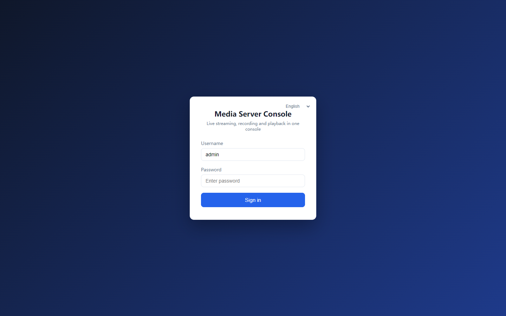
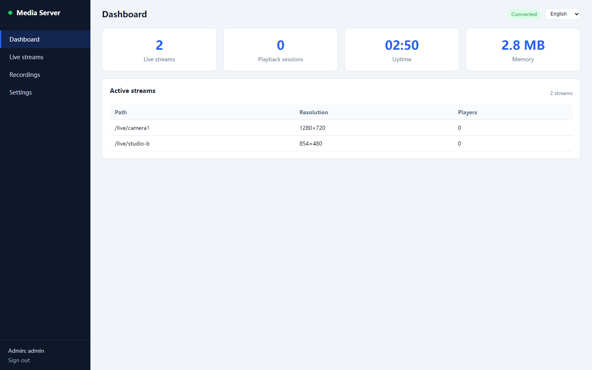
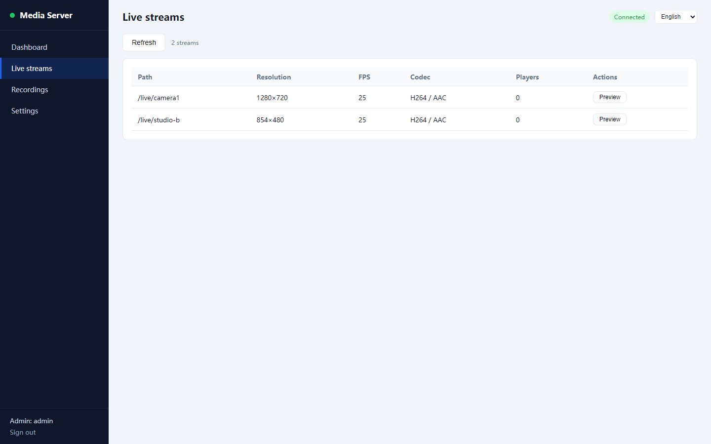
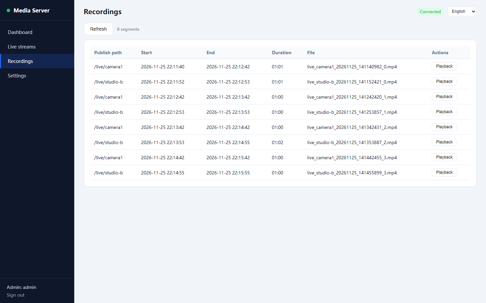
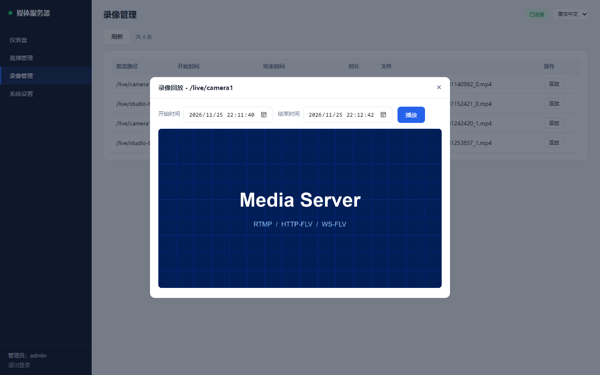
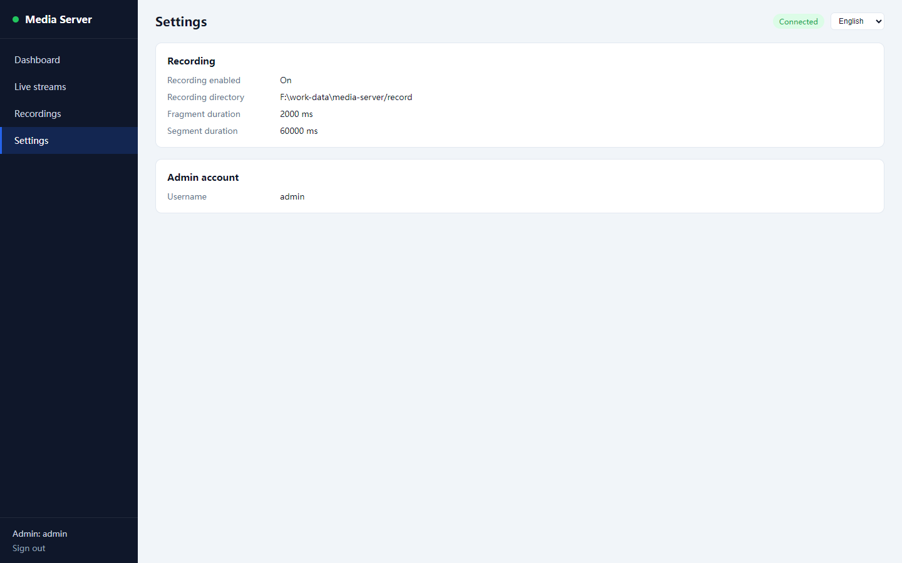
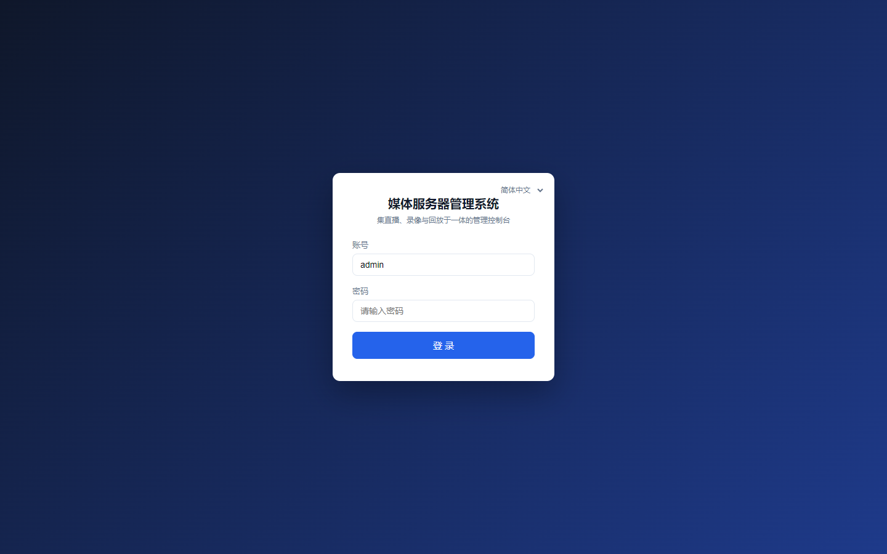
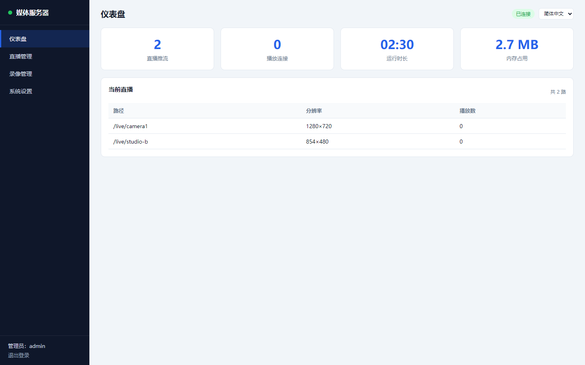
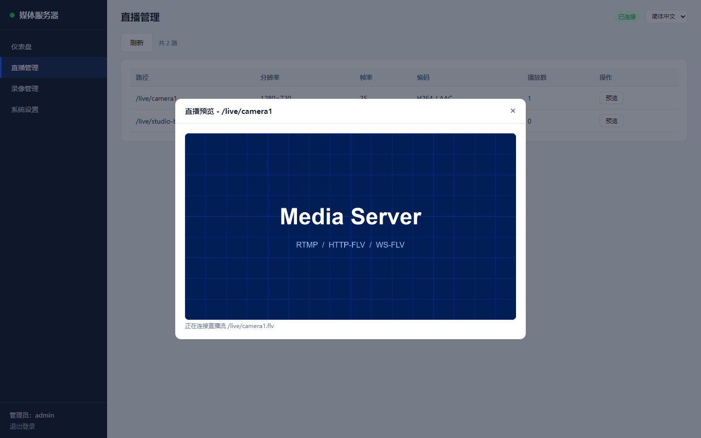
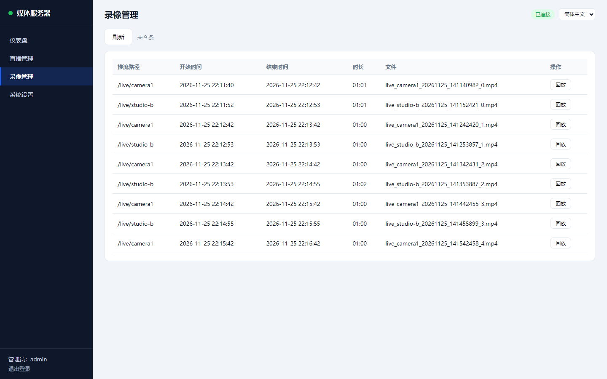

# PHP Media Server

[简体中文](README_ZH.md) | English

[](https://github.com/wy3/media-server/actions/workflows/ci.yml)
[](https://www.php.net/)
[](LICENSE)
[](https://github.com/wy3/media-server/releases)
[](https://wy3.github.io/media-server/)

> A media server built on [Workerman](https://www.workerman.net), implemented in PHP: RTMP/HTTP-FLV ingest, RTMP / HTTP-FLV / WS-FLV playback, fMP4 recording and time-range playback, plus a built-in admin console.

📺 Project site (screenshots and benchmark data): https://wy3.github.io/media-server/ · [简体中文](https://wy3.github.io/media-server/zh/)

## Table of Contents

- [Features](#features)
- [Requirements](#requirements)
- [Quick Start](#quick-start)
- [Screenshots](#screenshots)
- [Configuration](#configuration)
- [Recording and Playback](#recording-and-playback)
- [Admin API](#admin-api)
- [Performance Benchmarks](#performance-benchmarks)
- [Tests](#tests)
- [Project Layout](#project-layout)
- [Known Limitations](#known-limitations)
- [Acknowledgements](#acknowledgements)

## Features

### Live streaming

- Ingest
  - RTMP push to the ingest listener (`rtmp://<host>:1935/<app>/<stream>` by default)
  - HTTP-FLV push via `POST` with chunked FLV body to the ingest HTTP listener (`:18081` by default)
- Playback
  - RTMP: the play listener (`rtmp://<host>:1936/<app>/<stream>` by default)
  - HTTP-FLV: the play HTTP listener (`http://<host>:18080/<app>/<stream>.flv` by default)
  - WS-FLV: `ws://<host>:18080/<app>/<stream>.flv`
  - Playback filters via query string: `disableAudio`, `disableVideo`, `disableGop`
- Supported codecs: H.264 / H.265 (HEVC) video, AAC audio
- H.265 accepts both Enhanced RTMP (`codecId=0` + `hvc1` FourCC) and legacy `codecId=12`

### Recording

- Real-time muxing of H.264/AAC and H.265/AAC into fragmented MP4 (`ftyp + moov + moof/mdat`)
- Fragments are cut on keyframe boundaries (`fragmentDurationMs`, default 2000 ms)
- Segment rotation on keyframe boundaries (`segmentDurationMs`, default 60000 ms), one `.mp4` per segment
- Video-only, audio-only and audio+video streams are all supported
- Each segment carries a complete `moov`, so it plays standalone and is readable by `ffprobe` / browsers
- Segment index stored in SQLite (`recordings.db`, WAL mode), queryable per publish path

### Time-range playback

- `GET /playback/{publishPath}?start={ms}&end={ms}`
- `start` / `end` are wall-clock timestamps in milliseconds; omitting `end` plays through to the end
- The server slices across segments, re-muxes into a new fMP4 and streams it back as `video/mp4`
- Video starts at the nearest keyframe at or before `start`; audio start follows the video keyframe so both tracks stay aligned in duration
- Segment boundaries are stitched on a continuous decode timeline
- `mdat` payloads are streamed in chunks from the source files, so memory usage is independent of playback length

### Admin console

- Served at `http://<host>:18080/admin/`
- Token-based login (in-process token, default TTL 24 hours, invalidated on restart)
- Panels: dashboard, live streams, recordings (with time-range playback), settings
- Chinese / English UI, switchable from the top-right selector and remembered in browser localStorage

### E2E tests

- Data-driven suite covering push → record → playback → decode verification

## Requirements

- PHP >= 8.2 (tested on PHP 8.4), extension: `json`
- Composer
- Optional: `event` extension
  - **Strongly recommended on Windows**: the default `select` event loop hangs the entire process past ~253 connections (even the HTTP API stops responding). With `event` it handles 1000+ connections
  - Linux uses epoll and has no such limit; `event` still helps
  - Note: `ev` does **not** work on Windows (watching sockets raises `WSAENOTSOCK`); you must use `event`
- Running the E2E tests requires `ffmpeg` / `ffprobe`

## Quick Start

```bash
composer install
php start.php
```

All services run in multi-process mode. Listen addresses/ports and process counts are configured in `start.php` via `MediaServer\ServerConfig`:

| Service | Config fields | Default |
|---|---|---|
| Ingest RTMP | `$ingestRtmpHost` / `$ingestRtmpPort` | `0.0.0.0:1935` |
| Ingest HTTP-FLV | `$ingestHttpHost` / `$ingestHttpPort` | `0.0.0.0:18081` |
| Play RTMP | `$playRtmpHost` / `$playRtmpPort` | `0.0.0.0:1936` |
| Play HTTP-FLV / WS-FLV | `$playHttpHost` / `$playHttpPort` | `0.0.0.0:18080` |
| Admin | `$adminHttpHost` / `$adminHttpPort` | `0.0.0.0:18099` |
| Registry | `$registryHost` / `$registryPort` | `0.0.0.0:18090` |

Publish and playback have independent listeners. `$ingestCount` / `$playCount` / `$recordCount` control worker counts (extra instances offset ports by `+10`).

### Publish

```bash
ffmpeg -re -stream_loop 1 -i file.mp4 -c:v libx264 -c:a aac -f flv rtmp://127.0.0.1/live/stream
```

### Play

| Protocol | URL |
|---|---|
| RTMP | `rtmp://127.0.0.1/live/stream` |
| HTTP-FLV | `http://127.0.0.1:18080/live/stream.flv` |
| WS-FLV | `ws://127.0.0.1:18080/live/stream.flv` |

For web playback use [mpegts.js](https://github.com/xqq/mpegts.js) or [Aliplayer](http://player.alicdn.com/aliplayer/setting/setting.html); on desktop `vlc` / `ffplay` work out of the box.

### Admin console

Open `http://127.0.0.1:18080/admin/` in a browser. The default account is configured in `start.php`.

## Screenshots

The console ships with Simplified Chinese and English. Use the language selector in the top-right corner to switch; the choice is stored in browser localStorage.

| Login | Dashboard |
|---|---|
|  |  |

| Live streams | Recordings |
|---|---|
|  |  |

| Playback | Settings |
|---|---|
|  |  |

Simplified Chinese UI:

| 登录 | 仪表盘 |
|---|---|
|  |  |

| 直播预览 | 录像列表 |
|---|---|
|  |  |

## Configuration

Edit `start.php`:

```php
// Recording
\MediaServer\Recorder\RecorderManager::$enabled = true;                     // enable recording
\MediaServer\Recorder\RecorderManager::$recordPath = __DIR__ . '/record';   // recording root
\MediaServer\Recorder\RecorderManager::$fragmentDurationMs = 2000;          // fMP4 fragment duration
\MediaServer\Recorder\RecorderManager::$segmentDurationMs = 60000;          // segment file duration

// Admin console
\MediaServer\Admin\AdminAuth::$username = 'admin';
\MediaServer\Admin\AdminAuth::$password = 'admin123';
\MediaServer\Admin\AdminAuth::$tokenTtl = 86400;                            // token TTL in seconds
```

In production, always change the default credentials and put the admin console plus the playback endpoint behind a reverse proxy with access control.

## Recording and Playback

Recording layout:

```
record/
├── recordings.db           # SQLite index (streams + segments)
└── live_stream/            # one directory per publish path ("/" becomes "_")
    ├── xxx.mp4
    └── yyy.mp4
```

- Publish paths are sanitized into directory names, e.g. `/live/stream` → `live_stream`
- `recordings.db` keeps per-segment wall-clock start/end times, duration and codec metadata
- Playback requests are sliced and re-muxed server-side:

```http
GET /playback/live/stream?start=1788165249473&end=1788165554005
```

The response is `video/mp4` with a `Content-Length` header, so it can be assigned directly to a `<video src>`.

## Admin API

All management calls go through one endpoint:

```http
POST /api
Content-Type: application/json
X-Auth-Token: <token>

{"name": "listPushStream", "args": []}
```

Every call except `login` requires a valid token, supplied via `X-Auth-Token`, `Authorization: Bearer <token>`, or a `token` query parameter (401 otherwise).

| name | Description | args |
|---|---|---|
| `login` | Log in, returns `{token, expires}` | `[username, password]` |
| `logout` | Invalidate the current token | `[token]` |
| `getServerStats` | Uptime, publish/play counts, memory usage | `[]` |
| `listPushStream` | Live stream list, optionally filtered by path | `[path?]` |
| `listRecordFiles` | Recording segment list, optionally filtered by path | `[path?]` |
| `getPlayStreamCount` | Playback connection count per path | `[path?]` |
| `getSettings` | Current configuration (no secrets) | `[]` |

`GET /api?name=...&args=[...]` is also supported for read-only calls.

## Performance Benchmarks

The server runs as a set of single-purpose processes (control / ingest / play /
admin, recording optional) and scales horizontally by adding play or ingest
workers. Benchmarks use the automatic ramping strategy: +100 streams every 5 s
to each unsaturated worker, a worker is "saturated" when its own CPU stays
≥80% for 30 s, then the load is held for a 40 s stability check.

**Test conditions**: AMD Ryzen 9 9900X (12C/24T), Windows, PHP 8.4.25,
1080p30 4096 kb/s, ffmpeg `-c copy` push, rtmpstress pull, recording disabled.

### Pull capacity by play-worker count

| Play workers | Capacity (streams) | Avg CPU / worker | Memory (ws) | Note |
|---|---|---|---|---|
| 1 | 950 | ~99% | 102 MB | single play ceiling |
| 2 | 1600 | ~95% | 69 MB | near-linear |
| 5 | 3000 | 98% | 160 MB | best per-worker efficiency (~600/worker) |
| 6 | **3599** | 103% | 196 MB | **best overall capacity** |
| 8 | 3200 | 100% | 231 MB | system-level overhead appears (sys 80–99%) |
| 10 | 4000 | 86% | 288 MB | highest total, but only ~400/worker |

**Recommended**: 5–6 play workers. Beyond that, per-worker efficiency drops
sharply as system-level costs (scheduling, client-side stress tool, NIC)
dominate. JIT makes no difference to pull capacity (bottleneck is socket I/O).

### Push capacity (1 ingest worker)

| Config | Capacity | Avg CPU | Memory |
|---|---|---|---|
| Default | 800 | 90.5% | 931 MB |
| JIT enabled (`opcache.jit=tracing`) | 800 | **82.4%** | 953 MB |

Each push costs ~1.15 MB (GOP cache) and ~0.11% CPU. **Enabling JIT cuts
push-path CPU by ~9%** (FLV parsing is JIT-compiled) at a small memory cost —
recommended for ingest workers. Disabling GC showed no meaningful benefit.

### Further reading

| Document | Contents |
|---|---|
| [docs/rtmp-parsing-performance.md](docs/rtmp-parsing-performance.md) | RTMP parsing hot-path analysis |
| [tests/bench/PROCEDURE.md](tests/bench/PROCEDURE.md) | Full test procedure, setup, metric definitions, FAQ |
| [tests/bench/RESULTS.md](tests/bench/RESULTS.md) | Raw data and analysis (Chinese, historic single-process baselines + new multi-process) |
| [tests/bench/RESULTS_EN.md](tests/bench/RESULTS_EN.md) | Full data and analysis (English) |
| [tests/bench/README.md](tests/bench/README.md) | Benchmark suite usage |

Reproduce with:

```powershell
php tests/smoke.php
.\tests\bench\s4_ramp.ps1 -Scenario pull -PlayCount 6
.\tests\bench\s4_ramp.ps1 -Scenario push -EnableJit
.\tests\bench\gen_samples.ps1   # only if tests/bench/samples/ is missing
```

## Tests

Two suites are provided.

**Smoke tests** — no running server, no ffmpeg required (this is what CI runs):

```bash
php tests/smoke.php
```

Covers autoloading, MP4 box byte layout, RTMP handshake echo behaviour, AVC SPS parsing, recording path sanitization and SQLite index read/write.

**Playback E2E tests** — requires a running server plus `ffmpeg` / `ffprobe`:

```bash
php tests/playback_e2e.php            # run all cases
php tests/playback_e2e.php aonly      # run cases whose name matches
```

Cases are data-driven — add an entry to `$CASES` in `tests/playback_e2e.php`. Each case cleans old recordings, pushes with ffmpeg, waits for segments to land, issues playback requests, then validates tracks and duration with `ffprobe` and performs a full decode pass with `ffmpeg`.

CI runs syntax checks and the smoke suite on PHP 8.2 / 8.3 / 8.4 via GitHub Actions.

## Project Layout

```
src/
├── Admin/        Admin console auth (token based)
├── Flv/          FLV publish/play streams
├── Http/         HTTP server (live, playback, admin, static routing)
├── MediaReader/  FLV tag parsing (AVC/AAC packets)
├── PushServer/   Publish/play stream interfaces
├── Recorder/     fMP4 muxer/recorder, playback slicer, MP4 parser, SQLite index
├── Rtmp/         RTMP protocol handling
└── Utils/        Binary/HTTP/WS stream helpers
public/admin/     Admin console SPA (vanilla JS, i18n.js holds the zh/en dictionaries)
packages/         Vendored SabreAMF
tests/            Playback E2E tests
tests/bench/      Performance benchmark suite (procedure + scripts + results)
docs/screenshots/ Admin console screenshots used by the READMEs
docs/multiprocess/ Multiprocess architecture design (split by topic)
record/           Recording output (git-ignored)
```

## Known Limitations

- Only H.264 / H.265 (HEVC) + AAC streams are supported; other codecs may not work
- Browser playback of H.265 depends on OS-level HEVC decoding: on Windows the "HEVC Video Extensions" package must be installed, macOS / iOS Safari support it natively, and Chrome / Edge use the system decoder. Without it the video silently renders black (no error), so pre-flight with `video.canPlayType('video/mp4; codecs="hvc1.1.6.L93.B0"')`
- Pushing H.265 requires ffmpeg 7.x or newer (older builds cannot emit Enhanced RTMP)
- Multi-process deployment: control / ingest / play / admin run as separate single-purpose workers; add play workers to scale playback and ingest workers to scale publishing (extra instances offset ports by `+10`)
- **The default `select` event loop on Windows hangs the entire process past ~253 connections**; install the `event` extension (see [Requirements](#requirements)). Linux uses epoll and is unaffected
- Capacity ceiling per worker (1080p30 4 Mbps): ~950 pull streams or ~800 push streams; plan for 50% (~500 pull / ~400 push per worker) in production. See [Performance Benchmarks](#performance-benchmarks)
- The latency measurement method is only accurate to ±30 ms — it can detect order-of-magnitude degradation but not fine differences
- Streams that add or drop a track mid-flight are not handled (a mid-stream track switch can corrupt the active segment)
- The sample table for a playback request is built in memory, so very long ranges are best avoided; always bound `end` for long recordings
- Fast start / slow loading may be noticeable for some players
- Memory exhaustion is possible in specific environments — supervise the process in production

## Acknowledgements

- [Workerman](https://www.workerman.net)
- [Node-Media-Server](https://github.com/illuspas/Node-Media-Server)
- [sabreamf](https://code.google.com/archive/p/sabreamf/)

## License

[MIT](LICENSE)
