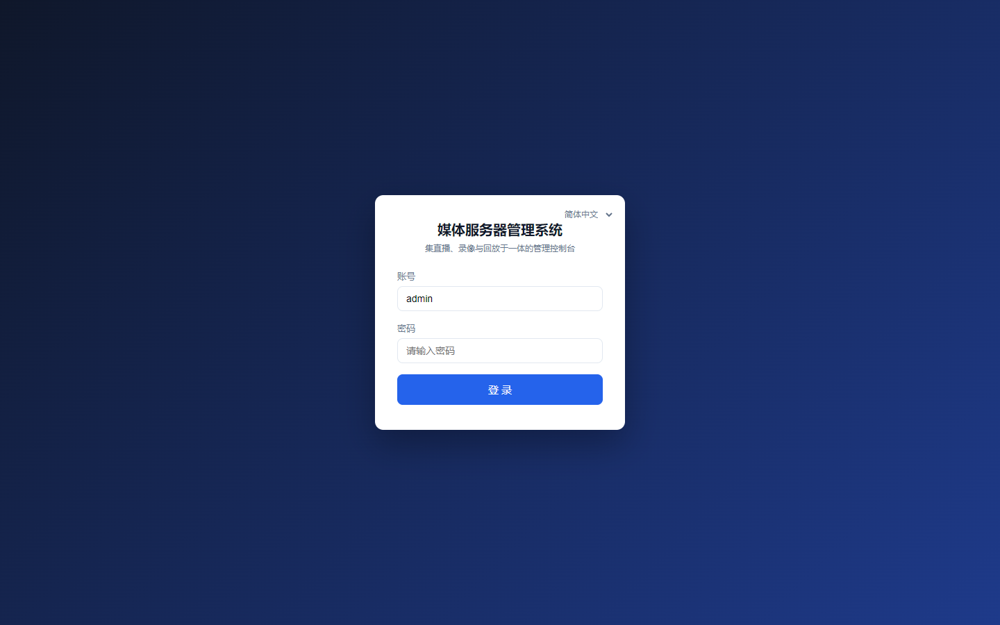
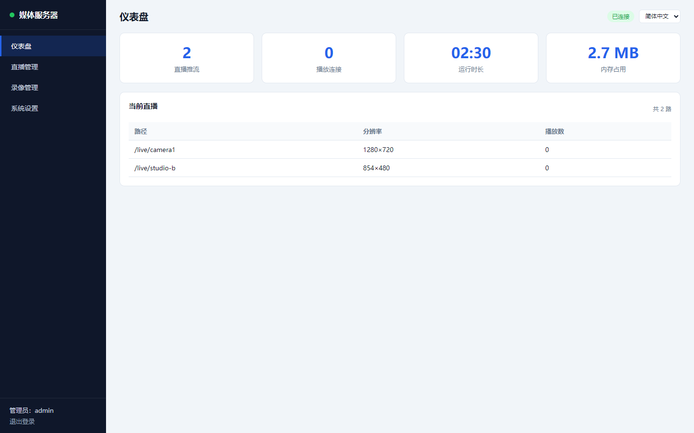
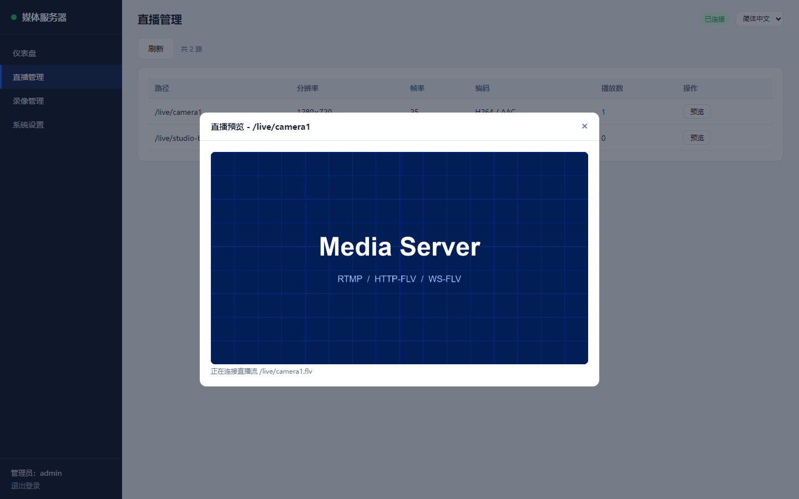
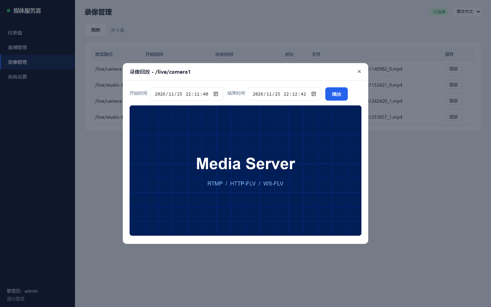
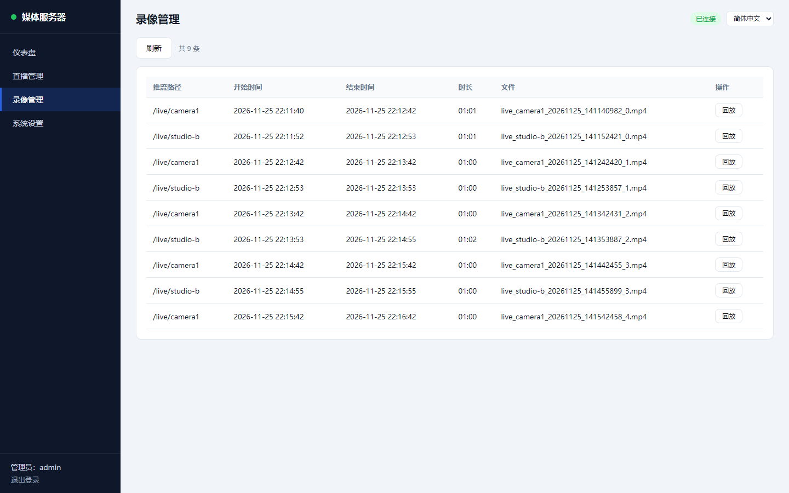
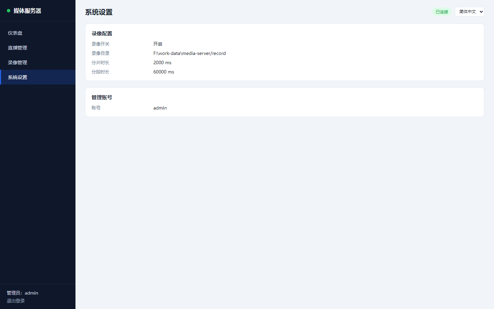
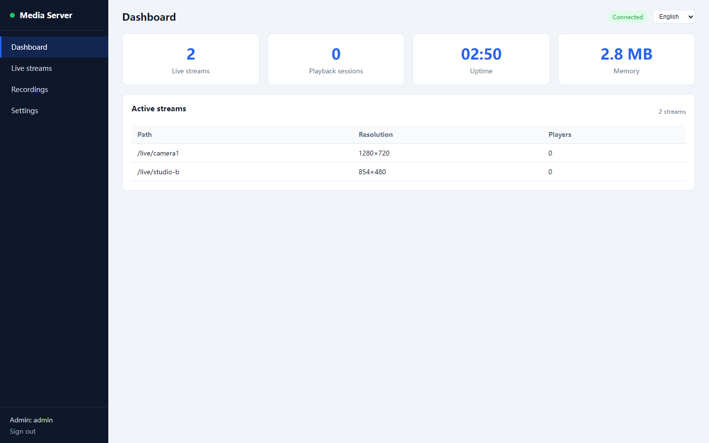
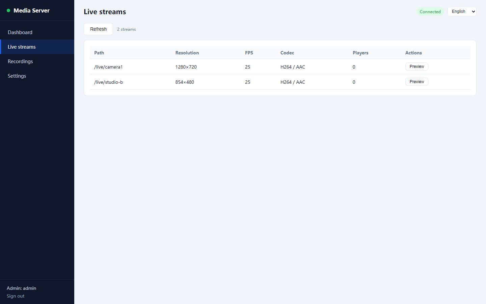
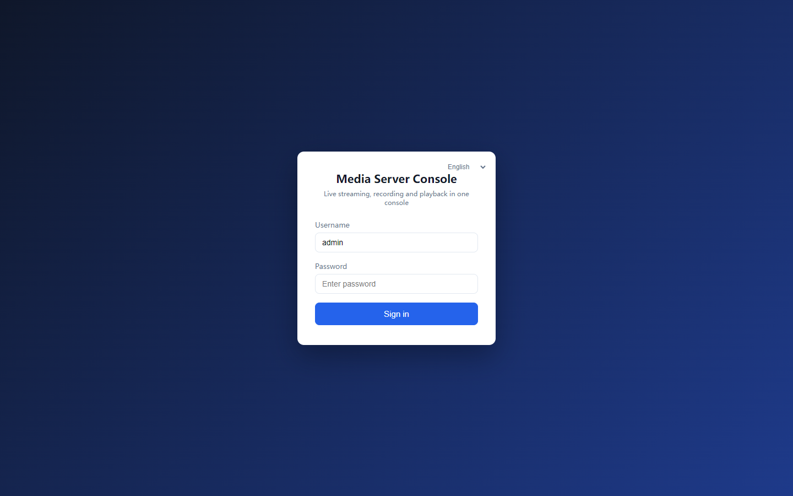
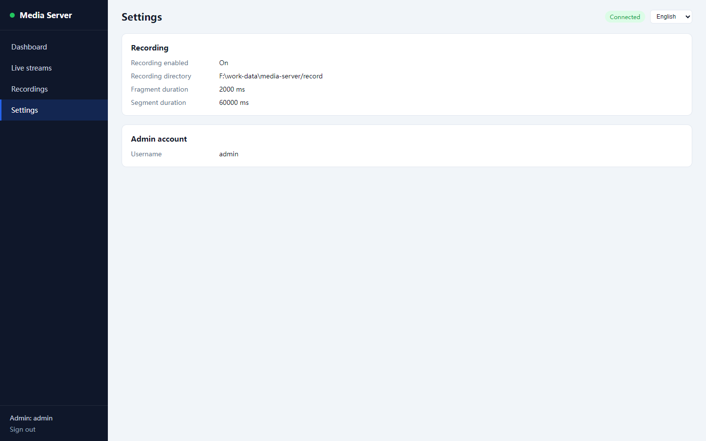

# PHP Media Server

[English](README.md) | 简体中文

[](https://github.com/wy3/media-server/actions/workflows/ci.yml)
[](https://www.php.net/)
[](LICENSE)
[](https://github.com/wy3/media-server/releases)
[](https://wy3.github.io/media-server/)

> 基于 [Workerman](https://www.workerman.net) 实现的 PHP 流媒体服务器：RTMP / HTTP-FLV 推流接入，RTMP / HTTP-FLV / WS-FLV 播放，fMP4 录像与指定时间回放，内置管理后台。

📺 项目主页（含界面预览与压测数据）：https://wy3.github.io/media-server/zh/ · [English](https://wy3.github.io/media-server/)

## 目录

- [功能特性](#功能特性)
- [环境要求](#环境要求)
- [快速开始](#快速开始)
- [界面预览](#界面预览)
- [配置](#配置)
- [录像与回放](#录像与回放)
- [管理 API](#管理-api)
- [性能基准](#性能基准)
- [测试](#测试)
- [目录结构](#目录结构)
- [已知限制](#已知限制)
- [致谢](#致谢)

## 功能特性

### 直播

- 推流接入
  - RTMP：推流监听地址（默认 `rtmp://<host>:1935/<app>/<stream>`）
  - HTTP-FLV：`POST` + chunked FLV 请求体，推流 HTTP 监听地址（默认 `:18081`）
- 播放分发
  - RTMP：播放监听地址（默认 `rtmp://<host>:1936/<app>/<stream>`）
  - HTTP-FLV：播放 HTTP 监听地址（默认 `http://<host>:18080/<app>/<stream>.flv`）
  - WS-FLV：`ws://<host>:18080/<app>/<stream>.flv`
  - 支持查询参数过滤：`disableAudio`、`disableVideo`、`disableGop`
- 编解码支持：H.264 / H.265（HEVC）视频、AAC 音频
- H.265 支持 Enhanced RTMP（`codecId=0` + `hvc1` FourCC）与旧版 `codecId=12` 两种封装

### 录像

- H.264/AAC、H.265/AAC 实时封装为 fMP4（`ftyp + moov + moof/mdat`）
- 按关键帧边界切分片（`fragmentDurationMs`，默认 2000 ms）
- 按关键帧边界轮转分段（`segmentDurationMs`，默认 60000 ms），每段一个独立 `.mp4`
- 纯视频流、纯音频流、音视频流均可录制
- 每个分段自带完整 `moov`，可单独播放，也可被 `ffprobe` / 浏览器直接解析
- 分段索引存于 SQLite（`recordings.db`，WAL 模式），支持按推流路径检索

### 指定时间回放

- `GET /playback/{publishPath}?start={毫秒}&end={毫秒}`
- `start` / `end` 为毫秒墙钟时间戳；省略 `end` 表示播放到末尾
- 服务端跨分段切片并重新封装为新的 fMP4，以 `video/mp4` 流式返回
- 视频从 `start` 之前最近的关键帧起播，音频起点跟随视频关键帧，保证音画时长一致
- 分段边界按解码时间轴连续续接
- `mdat` 数据按块从源分段文件流式发送，内存占用与回放时长无关

### 管理后台

- 入口：`http://<host>:18080/admin/`
- Token 登录鉴权（进程内 token，默认有效期 24 小时，服务重启后失效）
- 面板：仪表盘、直播管理、录像管理（含指定时间回放）、系统设置
- 中英双语界面，右上角切换语言，选择记录在浏览器 localStorage

### E2E 测试

- 数据驱动用例集，覆盖 推流 → 录像 → 回放 → 解码校验 全链路

## 环境要求

- PHP >= 8.2（已在 PHP 8.4 验证），扩展：`json`
- Composer
- 可选：`event` 扩展
  - **Windows 强烈建议**：默认 `select` 事件循环在约 253 连接后整个进程卡死（连 HTTP API 都不响应），装 `event` 后可支撑 1000+ 连接
  - Linux 用 epoll，无此限制；装 `event` 仍有收益
  - 注意：`ev` 在 Windows 上**不可用**（监视 socket 报 `WSAENOTSOCK`），必须用 `event`
- 运行 E2E 测试需要 `ffmpeg` / `ffprobe`

## 快速开始

```bash
composer install
php start.php
```

所有服务均按多进程模式运行。监听地址/端口和进程数在 `start.php` 中通过 `MediaServer\ServerConfig` 配置：

| 服务 | 配置字段 | 默认值 |
|---|---|---|
| 推流 RTMP | `$ingestRtmpHost` / `$ingestRtmpPort` | `0.0.0.0:1935` |
| 推流 HTTP-FLV | `$ingestHttpHost` / `$ingestHttpPort` | `0.0.0.0:18081` |
| 拉流 RTMP | `$playRtmpHost` / `$playRtmpPort` | `0.0.0.0:1936` |
| 拉流 HTTP-FLV / WS-FLV | `$playHttpHost` / `$playHttpPort` | `0.0.0.0:18080` |
| 管理后台 | `$adminHttpHost` / `$adminHttpPort` | `0.0.0.0:18099` |
| 注册中心 | `$registryHost` / `$registryPort` | `0.0.0.0:18090` |

推流与拉流各自独立监听。`$ingestCount` / `$playCount` / `$recordCount` 控制进程数（多实例时端口按 `+10` 递增）。

### 推流

```bash
ffmpeg -re -stream_loop 1 -i file.mp4 -c:v libx264 -c:a aac -f flv rtmp://127.0.0.1/live/stream
```

### 播放

| 协议 | 地址 |
|---|---|
| RTMP | `rtmp://127.0.0.1/live/stream` |
| HTTP-FLV | `http://127.0.0.1:18080/live/stream.flv` |
| WS-FLV | `ws://127.0.0.1:18080/live/stream.flv` |

Web 播放可配合 [mpegts.js](https://github.com/xqq/mpegts.js)、[Aliplayer](http://player.alicdn.com/aliplayer/setting/setting.html)；桌面端可用 `vlc` / `ffplay`。

### 管理后台

浏览器打开 `http://127.0.0.1:18080/admin/`，默认账号在 `start.php` 中配置。

## 界面预览

管理后台默认简体中文，点击右上角语言下拉框可切换 English，选择会保存在浏览器本地。

| 登录 | 仪表盘 |
|---|---|
|  |  |

| 直播管理与预览 | 录像回放 |
|---|---|
|  |  |

| 录像列表 | 系统设置 |
|---|---|
|  |  |

英文界面：

| Dashboard | Live streams |
|---|---|
|  |  |

| Login | Settings |
|---|---|
|  |  |

## 配置

编辑 `start.php`：

```php
// 录像
\MediaServer\Recorder\RecorderManager::$enabled = true;                     // 录像开关
\MediaServer\Recorder\RecorderManager::$recordPath = __DIR__ . '/record';   // 录像根目录
\MediaServer\Recorder\RecorderManager::$fragmentDurationMs = 2000;          // fMP4 分片时长
\MediaServer\Recorder\RecorderManager::$segmentDurationMs = 60000;          // 单个分段文件时长

// 管理后台
\MediaServer\Admin\AdminAuth::$username = 'admin';
\MediaServer\Admin\AdminAuth::$password = 'admin123';
\MediaServer\Admin\AdminAuth::$tokenTtl = 86400;                            // token 有效期（秒）
```

生产环境请务必修改默认账号密码，并将管理后台与回放接口置于反向代理的访问控制之后。

## 录像与回放

录像目录结构：

```
record/
├── recordings.db           # SQLite 索引（streams + segments）
└── live_stream/            # 每个推流路径一个目录（"/" 归一为 "_"）
    ├── xxx.mp4
    └── yyy.mp4
```

- 推流路径会安全化为目录名，例如 `/live/stream` → `live_stream`
- `recordings.db` 保存每段的起止墙钟时间、时长与编码元数据
- 回放请求在服务端完成切片与重封装：

```http
GET /playback/live/stream?start=1788165249473&end=1788165554005
```

响应为带 `Content-Length` 的 `video/mp4`，可直接赋给 `<video src>`。

## 管理 API

所有管理调用统一走一个入口：

```http
POST /api
Content-Type: application/json
X-Auth-Token: <token>

{"name": "listPushStream", "args": []}
```

除 `login` 外的调用都必须携带有效 token（`X-Auth-Token` 头、`Authorization: Bearer <token>`，或 `token` 查询参数），否则返回 401。

| name | 说明 | args |
|---|---|---|
| `login` | 登录，返回 `{token, expires}` | `[username, password]` |
| `logout` | 使当前 token 立即失效 | `[token]` |
| `getServerStats` | 运行时长、推流/播放数、内存占用 | `[]` |
| `listPushStream` | 直播流列表，可按路径过滤 | `[path?]` |
| `listRecordFiles` | 录像分段列表，可按路径过滤 | `[path?]` |
| `getPlayStreamCount` | 各路径的播放连接数 | `[path?]` |
| `getSettings` | 当前配置（不含敏感信息） | `[]` |

只读调用也支持 `GET /api?name=...&args=[...]`。

## 性能基准

服务按功能拆分为多个单用途进程（control / ingest / play / admin，录像可选），
通过增加 play 或 ingest 进程横向扩展。压测采用自动爬坡策略：每 5 秒向每个
未饱和进程追加 100 路；单进程 CPU 连续 ≥80% 维持 30 秒判定为饱和；随后
保持负载 40 秒做稳定性考核。

**测试条件**：AMD Ryzen 9 9900X（12C/24T）、Windows、PHP 8.4.25、
1080p30 4096 kb/s、ffmpeg `-c copy` 推流、rtmpstress 拉流、录像关闭。

### 拉流容量与 play 进程数

| play 进程数 | 容量（路） | 每进程平均 CPU | 内存(ws) | 说明 |
|---|---|---|---|---|
| 1 | 950 | ~99% | 102 MB | 单 play 上限 |
| 2 | 1600 | ~95% | 69 MB | 接近线性 |
| 5 | 3000 | 98% | 160 MB | 每进程效率最佳（~600/进程） |
| 6 | **3599** | 103% | 196 MB | **总容量最优** |
| 8 | 3200 | 100% | 231 MB | 系统级开销显现（sys 80–99%） |
| 10 | 4000 | 86% | 288 MB | 总量最高，但仅 ~400/进程 |

**推荐**：5~6 个 play 进程。再往上每进程效率明显下降，系统级开销
（调度、压测客户端、网卡）开始主导。JIT 对拉流容量无影响（瓶颈在 socket I/O）。

### 推流容量（1 个 ingest 进程）

| 配置 | 容量 | 平均 CPU | 内存 |
|---|---|---|---|
| 默认 | 800 | 90.5% | 931 MB |
| 开启 JIT（`opcache.jit=tracing`） | 800 | **82.4%** | 953 MB |

推流每路约 1.15 MB（GOP 缓存）、0.11% CPU。**开启 JIT 可降低推流路径约 9% CPU**
（FLV 解析被 JIT 编译），代价是少量内存——建议 ingest 进程开启。关闭 GC 无明显收益。

### 详细资料

| 文档 | 内容 |
|---|---|
| [docs/rtmp-parsing-performance.md](docs/rtmp-parsing-performance.md) | RTMP 解析热路径剖析 |
| [tests/bench/PROCEDURE.md](tests/bench/PROCEDURE.md) | 完整测试流程、环境准备、指标口径、常见问题 |
| [tests/bench/RESULTS.md](tests/bench/RESULTS.md) | 全部原始数据与逐项分析（中文，含旧单进程基线与新多进程数据） |
| [tests/bench/RESULTS_EN.md](tests/bench/RESULTS_EN.md) | Full data and analysis (English) |
| [tests/bench/README.md](tests/bench/README.md) | 测试套件使用说明 |

复现命令：

```powershell
php tests/smoke.php
.\tests\bench\s4_ramp.ps1 -Scenario pull -PlayCount 6
.\tests\bench\s4_ramp.ps1 -Scenario push -EnableJit
.\tests\bench\gen_samples.ps1   # 仅当 tests/bench/samples/ 不存在时
```

## 测试

仓库提供两套测试：

**冒烟测试**（不启动服务、不需要 ffmpeg，适合 CI）：

```bash
php tests/smoke.php
```

覆盖自动加载、MP4 box 字节结构、RTMP 握手回显、AVC SPS 解析、录像路径归一与 SQLite 索引读写。

**回放链路 E2E 测试**（需服务器已启动，且 `ffmpeg` / `ffprobe` 可用）：

```bash
php tests/playback_e2e.php            # 运行全部用例
php tests/playback_e2e.php aonly      # 只运行名称匹配的用例
```

用例为数据驱动，新增场景只需在 `tests/playback_e2e.php` 的 `$CASES` 中加一项。每个用例会清理旧录像、用 ffmpeg 推流、等待分段落盘、发起回放请求，再用 `ffprobe` 校验轨道与时长、用 `ffmpeg` 做全量解码校验。

CI 在 GitHub Actions 上对 PHP 8.2 / 8.3 / 8.4 执行语法检查与冒烟测试。

## 目录结构

```
src/
├── Admin/        管理后台鉴权（token）
├── Flv/          FLV 发布/播放流
├── Http/         HTTP 服务器（直播/回放/后台/静态文件路由）
├── MediaReader/  FLV 标签解析（AVC/AAC 包）
├── PushServer/   推流/播放流接口
├── Recorder/     fMP4 封装与录像、回放切片、MP4 解析、SQLite 索引
├── Rtmp/         RTMP 协议处理
└── Utils/        二进制/HTTP/WS 流工具
public/admin/     管理后台 SPA（原生 JS，i18n.js 提供中英文词典）
packages/         vendored SabreAMF
tests/            回放链路 E2E 测试
tests/bench/      性能基准测试套件（流程 + 脚本 + 结果）
docs/screenshots/ README 使用的管理后台截图
docs/multiprocess/ 多进程架构设计文档（按主题分册）
record/           录像输出目录（已 git 忽略）
```

## 已知限制

- 仅支持 H.264 / H.265（HEVC）+ AAC 编码流，其它编码可能无法正常工作
- 浏览器播放 H.265 依赖操作系统的 HEVC 解码能力：Windows 需安装「HEVC 视频扩展」，macOS / iOS Safari 原生支持，Chrome / Edge 走系统硬解；未安装时画面会静默黑屏（无报错），建议后台用 `video.canPlayType('video/mp4; codecs="hvc1.1.6.L93.B0"')` 预检
- H.265 推流推荐使用 ffmpeg 7.x 及以上（旧版无法输出 Enhanced RTMP）
- 多进程部署：control / ingest / play / admin 各为单用途进程；增加 play 进程扩展拉流、增加 ingest 进程扩展推流（多实例端口按 `+10` 递增）
- **Windows 默认 `select` 事件循环在约 253 连接后整个进程卡死**，必须安装 `event` 扩展（见[环境要求](#环境要求)）；Linux 用 epoll 无此问题
- 单进程容量上限（1080p30 4Mbps）：拉流约 950 路 / 推流约 800 路；生产建议按 50% 规划（每进程拉流 ~500 / 推流 ~400），详见[性能基准](#性能基准)
- 时延测试方法精度有限（±30ms），仅能检测数量级劣化，不能用于精细对比
- 推流过程中增删轨道未做处理（中途切换轨道会损坏当前分段）
- 回放请求的样本表在内存中构建，超长时间范围建议限制 `end`，避免内存与耗时膨胀
- 部分播放器可能存在加载缓慢或播放异常
- 特定环境下可能出现内存溢出，生产环境请配合进程守护与监控

## 致谢

- [Workerman](https://www.workerman.net)
- [Node-Media-Server](https://github.com/illuspas/Node-Media-Server)
- [sabreamf](https://code.google.com/archive/p/sabreamf/)

## License

[MIT](LICENSE)
   
