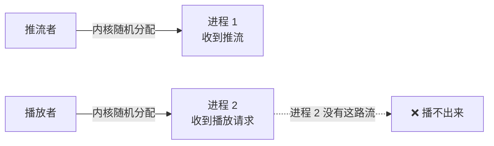
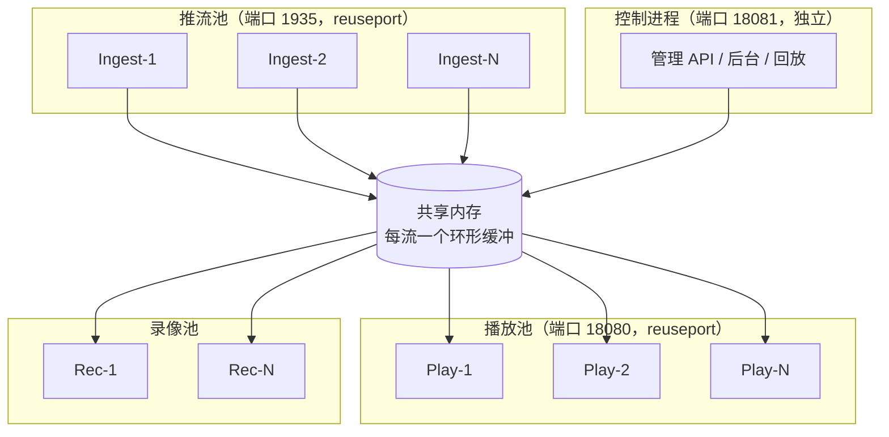
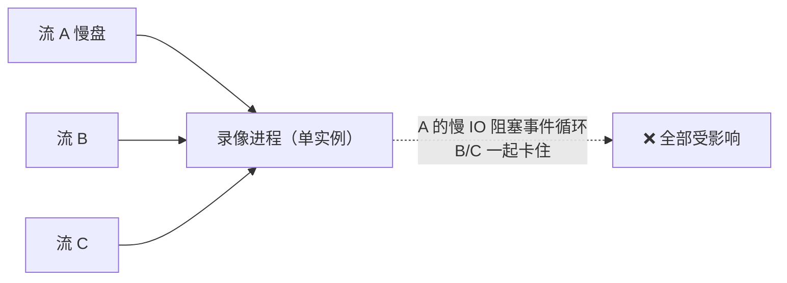
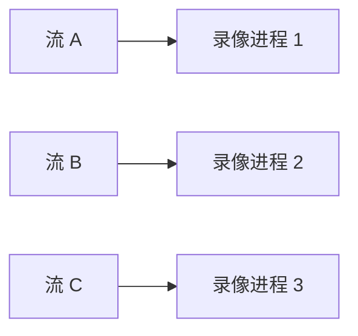

# 01. 进程模型

## 1. 已确定的设计约束

| 约束 | 决策 |
|---|---|
| **RTMP 端口** | 单一 1935，Linux 用 `SO_REUSEPORT` 多进程共享 |
| **Windows** | 单进程（无 `pcntl`，且复用端口不生效） |
| **推流/播放** | **分成两个独立的进程池** |
| **录像** | 不丢帧，独立进程 |
| **跨机器扩展** | 暂不考虑 |

## 2. 为什么必须区分推流池与播放池

这是本方案成立的前提。

`SO_REUSEPORT` 让内核**随机**把新连接分配给池中某个进程。如果推流和播放混在一个池里：



**结论**：推流连接必须只落到推流池，播放连接必须只落到播放池。
用**两个不同端口**实现隔离（内核按端口分别做 reuseport 负载均衡）。

## 3. 进程拓扑（Linux）



### 3.1 各池职责

| 池 | 端口 | 协议 | 职责 |
|---|---|---|---|
| **推流池** | 1935 | RTMP / HTTP-FLV 推流 | 解析封装、写共享内存、维护 GOP 缓存 |
| **播放池** | 18080 | HTTP-FLV / WS-FLV / RTMP 播放 | 读共享内存、转发帧 |
| **录像池** | 无 | — | 读共享内存、fMP4 封装、落盘 |
| **控制进程** | 18081 | HTTP | 管理后台、`/api`、录像回放 |

### 3.2 录像池为什么也要多进程

**因为单线程事件循环下，一路慢会拖慢全部。**

实测（见 [附录 A.10](./appendix-measurements.md)）：

```
场景 1：三路都快  → A: 0.000s  B: 0.000s  C: 0.000s
场景 2：只有 A 慢  → A: 3.077s  B: 3.057s  C: 3.057s
```

即使 B/C 自身处理耗时为 0，也必须等待 A 的慢 IO 完成。

**如果只有一个录像进程**：



**按 path 哈希分片到多个录像进程**：



| 分片方式 | 说明 |
|---|---|
| `crc32(path) % recorderCount` | ✅ **必须**：同一路流固定落一个进程 |

**为什么必须固定**：同一路流的分片若由不同进程写入，
文件序号（`segmentSeq`）与 SQLite 索引会冲突。

### 3.3 录像进程数建议

| 路数 | 进程数 | 说明 |
|---|---|---|
| < 10 | 1 | 单进程足够 |
| 10~30 | 2~3 | 隔离慢盘影响 |
| > 30 | 3~4 | **不宜再多** |

**注意**：多个进程并发写同一磁盘会互相拖慢。若磁盘是瓶颈，
增加进程数反而恶化——此时应换更快的盘或做 RAID。

### 3.4 背压必须收敛到单路流

推流进程判断是否阻塞时，只能看**该路流对应录像进程**的读位置：

```
if (writeSeq[path] - minRecSeq[path]) >= slotCount - 1:
    只阻塞这一路流的写入
    不影响其它 path
```

**不能**写成「任何录像进程慢就阻塞所有流」——那样一个慢盘会拖垮全部推流。

### 3.5 关键点：播放池不依赖"落在同一进程"

这正是 `SO_REUSEPORT` 能用的原因：

```
推流者 → 落到 Ingest-2 → 写入共享内存段 shm(/live/a)
播放者 → 落到 Play-5  → 打开 shm(/live/a) → 读帧 → 转发
```

**播放进程无需知道推流在哪个进程**，只需知道共享内存 key。
共享内存是进程无关的，任何进程都能 attach。

## 4. 共享内存 key 的发现

播放/录像进程需要知道某路流的共享内存 key。

### 4.1 方案：确定性 key（推荐）

`ftok` 依赖路径，不适合动态流。改用**从路径哈希推导 key**：

```php
/**
 * 从推流路径推导共享内存 key。
 *
 * 同一路径在所有进程中必须得到同一个 key，因此不能用 ftok（依赖文件）。
 * 用 crc32 保证跨进程、跨平台一致。
 *
 * @param string $path 推流路径，如 /live/cam1
 * @return int 共享内存 key
 */
function shmKeyForPath(string $path): int
{
    // 0x4D53 为命名空间前缀，降低与系统其它 shm 冲突的概率
    return (crc32('ms:' . $path) & 0x7FFFFFFF) | 0x4D530000;
}
```

**优点**：无需任何查询，所有进程算出的 key 一致。
**缺点**：不同路径理论上可能哈希冲突（crc32 碰撞概率极低，且可加长度校验）。

### 4.2 方案：控制进程维护映射

推流进程创建段后注册到控制进程，播放进程查询。

**优点**：无哈希冲突风险。
**缺点**：多一次查询，且控制进程成为依赖。

**建议**：用方案 4.1（确定性 key），并在段头写入路径字符串做校验。

## 5. 进程数量建议

### 5.1 推流池（有实测依据）

单推流进程只用 **1 个核**（事件循环单线程）。

**实测（1080p30 4096kb/s，event 循环）**：

| 负载 | 路数 | 内存 |
|---|---|---|
| 50% | **600** | 700 MB |
| 80% | 960 | 1.1 GB |
| 100% | 1200 | 1.4 GB |

每路单核占用约 **0.085~0.133%**（随路数增加而下降，固定开销被摊薄）。

**推流进程数**：

```
推流进程数 = ceil(总路数 / 600)
```

例：1200 路 1080p30 → `ceil(1200/600) = 2` 个进程。

**内存是推流的真约束**：约 **1.17 MB/路**（2s GOP × 30fps × 4Mbps 的 GOP 缓存）。
1200 路需 1.4 GB，这个数字必须计入部署规划。

### 5.2 播放池（按连接数，不按流数）

**实测（1080p30 4096kb/s，event 循环）**：

| 负载 | 连接数 | 内存 |
|---|---|---|
| 50% | **500** | 30 MB |
| 80% | 800 | 35 MB |
| 100% | 1000 | 36 MB |

每连接单核占用约 **0.10%**，内存仅 **36 KB/连接**。

**规划原则**：

| 项 | 建议 |
|---|---|
| 按**并发播放连接数**规划进程数 | 不按流数 |
| 单进程并发播放连接 | 保守取 **500** |
| 单路流被多人观看 | 同一进程内的扇出成本 = 连接数 × 0.10% |

例：50 路流、平均每路 20 人观看 = 1000 个播放连接
→ `ceil(1000/500) = 2` 个播放进程。

**注意**：拉流的内存几乎不随路数增长（36 KB/连接），
所以播放池的进程数只受 CPU 限制，不受内存限制。

### 5.3 录像池（按路数，受磁盘限制）

| 路数 | 进程数 | 说明 |
|---|---|---|
| < 10 | 1 | |
| 10~30 | 2~3 | |
| > 30 | 3~4 | 受磁盘 IO 限制，不宜更多 |

**录像池的两个相反约束**：

| 约束 | 方向 |
|---|---|
| 隔离慢盘影响 | 进程越多越好 |
| 避免并发写同一磁盘互相拖慢 | 进程越少越好 |

**权衡**：按路数决定。如果磁盘是瓶颈，加进程数反而恶化——应换更快的盘或做 RAID。

### 5.4 ⚠️ Windows 默认事件循环在约 253 连接后卡死

Windows 下 `select()` 的 `FD_SETSIZE` 只有 64（Workerman 扩到 256）。
**实测：200 路正常，300 路整个进程卡死** —— 连 HTTP 管理 API 都不响应。

```
档位 200: svc=25.1%  active=200/200    ✅
档位 300: svc=40.4%  active=-1/300     ❌ 事件循环停摆
```

**失效方式是「卡死」而不是「拒绝连接」**，运维看到进程活着但服务已完全不可用。
这比优雅降级危险得多。

#### 解决办法：装 `event` 扩展（已实测）

Windows 有可用的 libevent 绑定 —— **`event` 3.2.0**（不是 `ev`，`ev` 在 Windows
上监视 socket 会报 `WSAENOTSOCK`）：

```ini
; php.ini —— 顺序不能反，event 直接链接 php_sockets.dll
extension=sockets
extension=event
```

```php
// start.php
\Workerman\Worker::$eventLoopClass = '\Workerman\Events\Event';
```

实测对比（1080p30 4096kb/s，每档 40 秒）：

| 目标 | `select` | `event` |
|---|---|---|
| 100 路 | ✅ 100% 保持 | ✅ 100% 保持 |
| 200 路 | ✅ 100% 保持 | ✅ 100% 保持 |
| 300 路 | ❌ **卡死** | ✅ 100% 保持 |
| 600 路 | ❌ | ✅ 100% 保持 |
| 800 路 | ❌ | ✅ 100% 保持 |
| **1000 路** | ❌ | ✅ **100% 保持，CPU 102%** |
| **1200 路（推流）** | ❌ | ✅ **100% 保持，CPU 103%** |

因此 Windows 的容量结论：

| 部署 | 实际上限 |
|---|---|
| Windows（默认 `select`） | **约 200 路**，超过就卡死 |
| **Windows + `event`** | **拉流 1000 路 / 推流 1200 路** |
| Linux 多进程（epoll） | 无此限制，按 CPU 与 fd 上限 |

**代价**：需要多装 `php_event.dll` + `pthreadVC2.dll` 两个文件，
并额外启用 `sockets` 扩展。如果部署环境可选，**优先 Linux**——epoll 本来就没这问题。

## 6. Windows 单进程降级

Windows 无 `pcntl`，且实测多 Worker 在单入口文件下只跑第一个。

因此 Windows 所有职责合并为一个进程，行为等同现状。

### 6.1 避免代码分叉：FrameBus 抽象

```php
interface FrameBusInterface
{
    /**
     * 发布一帧。
     *
     * @param string $path 推流路径
     * @param string $data 帧数据
     * @param bool $isKey 是否关键帧
     * @return int 序号
     */
    public function publish(string $path, string $data, bool $isKey): int;

    /**
     * 订阅某路流。
     *
     * @param string $path 推流路径
     * @param callable $onFrame 帧回调
     * @return void
     */
    public function subscribe(string $path, callable $onFrame): void;
}
```

| 实现 | 场景 |
|---|---|
| `InProcessFrameBus` | Windows / 单进程（**现有 `publisherOnFrame` 逻辑**） |
| `SharedMemoryFrameBus` | Linux 多进程 |

上层代码（推流解析、fMP4 封装、播放转发）**完全不知道用的是哪种**。

## 7. 与旧方案的差异

| | 旧方案（Gateway 移交 socket） | 本方案 |
|---|---|---|
| 连接归属 | Gateway 接收后移交 | **各池自己收** |
| fd 传递 | 需要 | **不需要** |
| 杀软风险 | 高（实测被拦） | 无 |
| 推流扩展性 | 受 Gateway 限制 | **`reuseport` 线性扩展** |

**代价**：播放进程无法保证与推流同进程（靠共享内存解决）。

## 8. 待设计项

| 项 | 说明 |
|---|---|
| 共享内存段的创建与回收 | 推流进程创建；最后离开的消费者负责删除 |
| 推流断开后段的清理 | 需引用计数或超时回收 |
| 控制进程崩溃的影响 | 仅影响管理功能，不影响媒体流转发 |
| GOP 缓存位置 | 放共享内存段内（见 02） |
