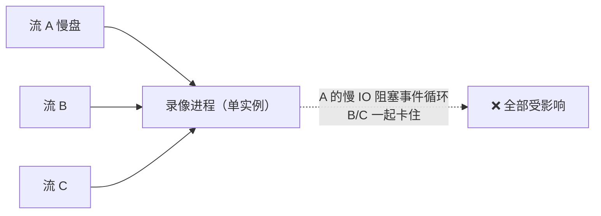
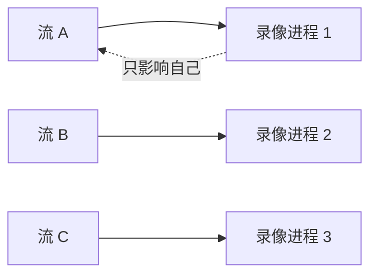

# 02. 共享内存扇出（数据面）

推流进程写一帧，播放/录像进程各自读取。这是 `SO_REUSEPORT` 多进程架构的基础。

## 1. 为什么可行

**帧数据是只读的**。同一帧被多个消费者同时读取互不影响，只要各消费者维护自己的读位置。

已实测（见 [附录 A.1](./appendix-measurements.md)）：

```
推流进程: 2000 帧 / 0.039s (5042 MB/s, 51634 帧/s)
PLAY: 收到=2000 损坏=0 速率=52058 帧/s
REC:  收到=2000 损坏=0 速率=52000 帧/s
判定: 两个消费者均收到全部 2000 帧且无损坏
```

## 2. 数据结构

每路流一个 `shmop` 段，内含**段头 + 环形缓冲**。

### 2.1 段头（固定 4KB）

```
偏移  长度  字段
0     4     magic      固定 0x4D534652 ("MSFR")
4     4     version    结构版本，用于升级兼容
8     256   path       推流路径（用于校验哈希冲突）
264   4     slotCount  槽位数量
268   4     slotSize   单槽大小（字节）
272   8     writeSeq   当前写入序号（生产者更新）
280   8     lastKeySeq 最近关键帧序号
288   8     minRecSeq   录像进程读位置（用于背压）
296   8     refCount    活跃消费者计数
304   8     producerPid 推流进程 pid
312   ...   保留
4096  -    环形缓冲起点
```

### 2.2 槽位布局

```
┌──────┬──────┬──────┬──────┬─────────────┐
│ len  │ seq  │ crc  │ flags│ payload     │
│ 4B   │ 8B   │ 4B   │ 4B   │ len 字节    │
└──────┴──────┴──────┴──────┴─────────────┘
```

| 字段 | 用途 |
|---|---|
| `len` | 帧长度，0 表示空槽 |
| `seq` | 单调递增序号，**用于检测覆盖** |
| `crc` | 帧内容校验和 |
| `flags` | bit0 = 关键帧 |
| `payload` | AVCC/HVC1 格式的 NALU 数据 |

## 3. 消费者同步：组播通知（现行）与轮询（历史）

> 📌 **2026-11-26 更新**：消费者唤醒机制从「Timer 轮询」改为「**UDP 组播通知 + EV_READ**」。
> 下面 3.1~3.3 保留原始轮询推演作为历史参考，
> **最新决策与实测见 [3.0 组播通知（现行方案）](#30-组播通知现行方案)**。

### 3.0 组播通知（现行方案）

#### 为什么改

Windows 上 **Timer 1ms 实际间隔 15ms**（两个事件循环都实测过）：

| 事件循环 | Timer(1ms) 中位 | p99 | 最大 |
|---|---|---|---|
| event | 15.45 ms | 30.58 ms | 31.28 ms |
| select | 15.45 ms | 16.07 ms | 16.15 ms |

实测（脚本为临时插桩，未入库）：
15ms 对 30fps（33ms/帧）是半帧延迟，p99 30ms 接近一帧，不够理想。

#### 为什么不能逐路单播通知

用户指出：1000 路推流 × 30fps × 10 个播放进程 = **300,000 次/s**。
实测 UDP send 2 µs/次 → **59% 单核**，不可接受。
脚本：`tests/bench/verify_star_cost.php`。

根本原因：`SO_REUSEPORT` 下推流进程不知道哪路流被哪些播放进程订阅，
逐路广播给所有进程会产生 N×M 次通知。

#### 组播方案

**一次 send，所有订阅的播放进程都收到**，通知次数与播放进程数无关：

```
推流进程：
  写 shmop 帧 → UDP 组播 send(streamKey)  一次

播放进程（M 个）：
  都加入同一组播组 → EV_READ 收到通知 → 读 shmop → 发帧
```

| 指标 | 值 |
|---|---|
| 通知次数 | 1000 路 × 30fps = **30,000 次/s**（与 M 无关） |
| 组播 send 成本 | 2.65 µs（单播 1.9 µs 的 1.39x） |
| CPU | **7.96% 单核** |
| 端到端延迟 | **5.9 µs**（Timer 15ms 的 1/2542） |

#### 跨平台 loopback 组播配置（Windows / Linux 不同！）

组播地址必须是 **D 类地址 224.0.0.0~239.255.255.255**，**不能用 `127.0.0.1`**
（那是单播地址）。但组播流量可以走 loopback 接口。两个平台的关键差异：

| 平台 | 发送端 `IP_MULTICAST_IF` | 接收端 `MCAST_JOIN_GROUP` 的 `interface` |
|---|---|---|
| **Windows** | 不设置（默认走 loopback，实测通过） | **必须整数索引**：`0`=自动，`1`=loopback |
| **Linux** | **必须显式 `'127.0.0.1'`** | **必须 `'127.0.0.1'` 或 `lo`** |

> ⚠️ **Linux 路由黑洞**：不显式指定 `IP_MULTICAST_IF` 时，内核按路由表把组播包
> 发往默认网卡（如 `eth0`），不会走 `lo`。现象是 `socket_sendto` **返回成功但接收端
> 死活收不到**。这不是 PHP 的问题，是内核路由策略。必须在两端都显式绑定 loopback 接口。

Windows PHP 8.4 **不支持** `IP_ADD_MEMBERSHIP` 常量（undefined）。
必须用跨平台的 `MCAST_JOIN_GROUP`（=41），且 **Windows 的 `interface` 必须传整数索引**，
不能传 IP 字符串（传 `'0.0.0.0'` 会返回"成功"但实际收不到包）：

```php
// 接收端加入组播
$iface = PHP_OS_FAMILY === 'Windows' ? 0 : '127.0.0.1';  // 平台差异！
socket_set_option($sock, IPPROTO_IP, MCAST_JOIN_GROUP, [
    'group'     => $group,
    'interface' => $iface,
]);

// 发送端
socket_set_option($sock, IPPROTO_IP, IP_MULTICAST_TTL, 1);
socket_set_option($sock, IPPROTO_IP, IP_MULTICAST_LOOP, 1);
if (PHP_OS_FAMILY !== 'Windows') {
    socket_set_option($sock, IPPROTO_IP, IP_MULTICAST_IF, '127.0.0.1');  // Linux 必须
}
socket_sendto($sock, $payload, strlen($payload), 0, $group, $port);
```

实测：两个独立进程加入组播组，一次 send 50 包 → **两个进程都收到 50 包**。
脚本：`tests/bench/verify_multicast.php`。

#### 组播隔离：三重机制（必须）

固定 group + 固定端口有**双向串扰风险**：别的程序可能发到你的组（你收到并处理），
你也可能发到别人的组（信息泄露）。实测：

```
固定 group + magic token:
  server: mine=30 foreign=10   ← 仍能收到别人的包，只是校验后丢弃
```

采用**三重隔离**：

| 层 | 机制 | 空间 | 效果 |
|---|---|---|---|
| 1 | 随机 group（239.x.x.x，排除 .0/.255） | 1600 万 | 外部程序不知道你的组 |
| 2 | 随机端口（20000~60000） | 4 万 | group 撞上端口也不同 |
| 3 | magic token（md5(instanceId) 前 16B） | ~0 碰撞 | 万一全撞上，校验后丢弃 |

组合空间 ≈ **6710 亿**，实测隔离效果：

```
随机 group + 随机端口 + token:
  client: 发 20 正确 + 20 错误 group + 20 错误端口
  server: mine=20 other=0      ← 完全隔离
```

脚本：`tests/bench/verify_multicast_iso2.php`。

**实例参数传递**：group / port / token 由**控制进程**启动时生成，所有 worker 必须一致。
Windows 无 `pcntl_fork`，子进程通过 `proc_open` 启动，这三个值通过**命令行参数或环境变量**传入：

```php
// 控制进程
$instanceId = random_bytes(16);
$group = randomMulticastGroup();   // 239.x.x.x
$port  = random_int(20000, 60000);
$token = md5($instanceId, true);

// 传给子进程（命令行参数）
$cmd = PHP_BINARY . " worker.php " . escapeshellarg("$group $port " . bin2hex($token));
```

**验证脚本**：`tests/bench/verify_multicast_iso2.php`。

#### EV_READ 回调：必须循环读到空（实测）

发送端突发 100 包/批、共 1000 包时，两种读取策略对比：

| 读取策略 | 回调次数 | 单次最多读包数 | 平均每次 |
|---|---|---|---|
| 每次回调只读 1 个包 | **1000 次** | 1 | 1.00 |
| 循环读到空（EAGAIN） | **400 次** | **21 个** | 2.50 |

**结论**：EV_READ 回调里必须 `while` 循环读到空，否则突发时回调次数是必要的
2.5 倍，浪费事件循环调度开销。脚本：`tests/bench/verify_evread_batch.php`。

⚠️ **Workerman Event 扩展的 PHP 8 坑**：`Event::add()` 内部用 `(int)$fd`，
**不支持 PHP 8 的 `Socket` 对象**（`socket_create()` 返回值），会报：

```
PHP Warning: Object of class Socket could not be converted to int
PHP Fatal: socket_recvfrom(): Argument #1 must be of type Socket, int given
```

**必须用 `stream_socket_server('udp://...')` 创建 UDP socket**（返回 resource），
不能用 `socket_create()`。但注意 stream 的 `fread` 会把多个 UDP 数据报合并读入，
payload 必须用**固定长度**（4 字节 streamKey）或自带长度前缀，按 4 字节对齐解析。

#### 通知策略：每帧立即通知（事件驱动，无定时器）

每写完一帧就发一次组播通知，payload 只有 streamKey（4 字节），不含帧数据。
帧数据始终在 shmop 里，通知只是「去读」的提示。

**尾帧问题**：攒批才通知会有尾部延迟。本方案每帧都通知，**没有尾帧问题**。
未来若高负载需要攒批，尾帧靠「播放端取最新帧」天然兜底——下一帧通知带同一个
key，播放端一次取走最新帧，不会永久漏帧。

#### 组播性能实测

**发送端吞吐**（`verify_multicast_perf.php send_bench`）：

| payload | 单次 send | 可持续速率 |
|---|---|---|
| 4 B | 4.41 µs | 226,933 次/s |
| 8 B（streamKey） | 4.56 µs | 219,064 次/s |
| 100 B | 4.97 µs | 201,359 次/s |
| 1500 B | 4.19 µs | 238,530 次/s |

成本与 payload 大小无关，主要是 syscall 开销。
**1000 路 × 30fps = 30,000 次/s → 约 11% 单核**。

**组合成本**（`verify_multicast_perf.php combo`）：

| 操作 | 单次成本 |
|---|---|
| `shmop_write(16 KB 帧)` | 129.5 ns |
| 组播 `send(8 B key)` | 3608 ns |
| 合计（单帧） | 3875 ns |

→ 30,000 次/s 合计 **11.63% 单核**。组播通知是主要成本，但仍可接受。

**多进程接收**（1 发送 + 3 接收，30k/s；脚本已合并到 `verify_no_loss.php`）：

| 指标 | 值 |
|---|---|
| 发送达成速率 | 29,954 包/s |
| 每个接收进程 | 17,179~17,191 包/s |
| 接收端 busy | 2.79~2.81% |

**早期丢包分析**（脚本已删除；结论：早期 10.2% 丢包是测试脚本缺陷，见下方零丢包验证）：

| 类型 | 发送 | 接收 | 丢包率 |
|---|---|---|---|
| 单播 loopback | 240,000 | 215,418 | **10.2%** |
| 组播 loopback | 240,000 | 215,560 | **10.2%** |

**关键结论：单播与组播丢包率完全相同**，说明丢包来自 Windows UDP 接收缓冲区 +
PHP 用户态循环，而**不是组播机制本身**。且丢包率与发送速率无关（1k~30k 恒定），
是内核 socket 缓冲与调度问题。

**为什么丢通知不影响正确性**：
1. 帧数据始终在 shmop 里（不随通知丢失）
2. 通知只是「去读」的提示，丢了下一帧通知带同一个 key，播放端自然追上
3. 播放端取**最新帧**，丢掉的那帧在 33ms 后本就过期，属于设计内行为

> **2026-11-26 更正**：上面 10.2% 丢包是**测试脚本缺陷**（接收循环 `usleep(100)`
> 睡太久 + 统计不准），不是 UDP 本身的问题。用带序号的精确校验重测后，
> **单播和组播都能做到零丢包**，见下节。

#### 零丢包验证（序号校验，推荐实现依据）

`tests/bench/verify_no_loss.php` 给每个包带 4 字节序号，接收端校验总数、连续性、
重复——比「只统计收到多少」精确得多：

| 场景 | 速率 | SO_RCVBUF | 单播 | 组播 |
|---|---|---|---|---|
| 10,000 包 | 1,000/s | 默认 64 KB | **10000/10000，missing=0 dup=0** | **10000/10000，missing=0 dup=0** |
| 30,000 包 | 30,000/s | 4 MB | **30000/30000，missing=0 dup=0** | **30000/30000，missing=0 dup=0** |

**零丢包的必要条件**（实测）：
1. 接收端用**非阻塞纯轮询**（`socket_set_nonblock` + 不 sleep），或 EV_READ 事件驱动
   （回调里循环读到空）——之前的 `usleep(100)` 会让 socket 缓冲区满
2. 高速率场景把 `SO_RCVBUF` 调大（4 MB 实测 30k/s 零丢包；默认 64 KB 也够 1k/s）

实际实现两者都做：**EV_READ 事件驱动 + 大接收缓冲区**，即使偶发丢通知也不影响正确性
（帧在 shmop，下帧通知带同 key 自然追上）。

#### 验证脚本（保留）

| 脚本 | 验证内容 |
|---|---|
| `verify_shmop_basic.php` | shmop 创建/写入/读取/key 稳定性/清理 |
| `verify_shmop_cross_process.php` | 父子进程双向读写 |
| `verify_framebus_fanout.php` | 环形缓冲单写多读（2000 帧 × 2 读者，0 损坏） |
| `verify_multicast.php` | 组播一次 send 多进程接收 |
| `verify_multicast_iso2.php` | 随机 group+port+token 三重隔离（`mine=20 other=0`） |
| `verify_udp_evread.php` | UDP socket 注册 EV_READ 到 Workerman |
| `verify_evread_batch.php` | EV_READ 批量读取（一次回调最多 21 包） |
| `verify_multicast_perf.php` | 组播发送吞吐 + shmop 组合成本 |
| `verify_no_loss.php` | **权威**：序号校验零丢包（30k/s × 30000 包全收全） |
| `verify_star_cost.php` | 星形广播成本核算（否决依据） |
| `verify_poll_cost.php` | shmop 轮询成本（对照数据） |

---

### 3.1 实测：轮询成本极低（历史）

| 操作 | 单次耗时 |
|---|---|
| 批量读 100 路序号（1600 字节） | **0.05 µs** |
| 单路读序号（4 字节） | 0.038 µs |

**推算开销**（100 路流）：

| 轮询间隔 | 每秒次数 | CPU 占用 |
|---|---|---|
| 1 ms | 1000 | 0.0051% |
| 2 ms | 500 | 0.0026% |
| 5 ms | 200 | 0.0010% |

**结论**：轮询 100 路流的全部序号，间隔 2ms，CPU 占用 **0.0026%**。
远优于 socket 通知（实测 0.025 ms/帧，3000 帧/s 需 75 ms/s）。

### 3.2 采用轮询（但**不能**用单定时器遍历所有流）

```php
// 播放进程的事件循环中，每 2ms 检查一次
Timer::add(0.002, function () use ($streams) {
    foreach ($streams as $stream) {
        $seq = $stream->readWriteSeq();
        if ($seq > $stream->lastSentSeq) {
            $frames = $stream->readFrom($stream->lastSentSeq + 1, $seq);
            foreach ($frames as $f) {
                $this->sendToPlayer($f);
            }
        }
    }
});
```

**注意**：2ms 轮询对 30fps（33ms/帧）足够及时，延迟增加 < 2ms。

### 3.3 ⚠️ 上面的单定时器写法会丢帧

轮询**读序号**很便宜（0.05 µs），但**取帧 + 发给播放端**不便宜。
如果所有流共用一个定时器、串行遍历，就必须满足：

$$
N \times t_{stream} < \text{轮询间隔}
$$

而 `t_stream` 包含从 shm 读帧（`shmop_read`）+ 封 FLV tag + 写 socket。
按实测，1080p 单帧封包 + 写出约 **1.0 µs**，但 `shmop_read` 与 socket
写缓冲在拥塞时会显著变慢。

| 路数 | 假设 `t_stream = 5 µs` | 单轮耗时 | 2ms 定时器 |
|---|---|---|---|
| 10 | | 50 µs | ✅ |
| 100 | | 500 µs | ✅ |
| 400 | | 2 ms | ⚠️ 刚好打满，持续落后 |
| 800 | | 4 ms | ❌ 每轮都超时，永久积压 |

**更严重的是「持续落后」**：一旦单轮耗时 > 轮询间隔，定时器回调会连续触发，
事件循环被占满，`recv` 与 `write` 都得不到调度 —— 这不是丢帧，是**雪崩**。

这正是 [附录 A.10](./appendix-measurements.md) 里跨流拖累的翻版：
一路慢（socket 写阻塞）会拖慢同进程内所有流的发送。

#### 正确做法：按流独立推进，且限制单轮工作量

```php
// 每个流有自己的下次触发时间，单轮只处理"该发了"的流
Timer::add(0.002, function () use ($streams) {
    $now = microtime(true);
    foreach ($streams as $stream) {
        if ($stream->nextSendAt > $now) {
            continue;
        }
        $seq = $stream->readWriteSeq();
        if ($seq <= $stream->lastSentSeq) {
            continue;
        }
        // 只取最新一帧（播放允许丢帧），不追赶积压
        $stream->lastSentSeq = $seq;
        $this->sendToPlayer($stream->readLatest());
        $stream->nextSendAt = $now + 1.0 / $stream->fps;
    }
});
```

**三条原则**：

| 原则 | 理由 |
|---|---|
| 播放端**只取最新帧**，不补发积压 | 直播优先低延迟；补发积压会让单轮耗时失控 |
| 每流有独立的 `nextSendAt` | 单轮耗时不再正比于路数，只正比于「本轮该发的流数」 |
| 单轮设工作量上限 | 超过上限就 `return`，下一轮继续（避免单轮无限长） |

**根本约束**：播放进程的路数上限 = `1 / (fps × t_stream)`。
1080p30 下若 `t_stream = 20 µs`，单进程约 **1600 路**；
但 socket 写阻塞会让 `t_stream` 变成毫秒级，因此**播放进程数必须按并发播放连接数
（而不是流数）来规划**，见 [01-process-model.md](./01-process-model.md) 第 5 节。

## 4. 录像不丢帧：背压设计

**决策：录像不丢帧。**

### 4.1 消费者策略对比

| 消费者 | 掉队时 | 理由 |
|---|---|---|
| **录像** | **阻塞生产者**（最多 5s） | 不丢帧 |
| **播放** | **丢帧跳到最新** | 直播低延迟优先 |

### 4.2 缓冲区容量（按实测帧尺寸修正）

**先看实测帧尺寸分布**（见 [附录 A.11](./appendix-measurements.md)）：

| 样本 | 平均 | p99 | 最大 |
|---|---|---|---|
| 720p30 2 Mbps | 3.6 KB | 15.2 KB | 34.4 KB |
| 1080p30 4 Mbps | 6.7 KB | 26.4 KB | 61.1 KB |
| 1080p30 8 Mbps | 13.3 KB | 47.3 KB | 80.7 KB |
| 4K30 20 Mbps | 33.1 KB | 160.0 KB | **256.9 KB** |

**槽位必须按最大值（关键帧）定，不是按平均值**——槽位小于关键帧会截断数据，
录像直接无法解码。

| 目标分辨率 | 槽位 | 依据 |
|---|---|---|
| ≤1080p | **128 KB** | 最大 80.7 KB，留 1.6× |
| 4K | **512 KB** | 最大 256.9 KB，留 2× |

**槽位数按「需要吸收多久的消费者滞后」定**：

| 槽位数 | 1080p30 缓冲时长 | 4K30 缓冲时长 |
|---|---|---|
| 64 | 2.1 s | 2.1 s |
| 128 | 4.3 s | 4.3 s |
| 256 | 8.5 s | 8.5 s |

（时长只取决于槽位数与 fps，与码率无关）

**单流内存** = `4096 + slotCount × (24 + slotSize)`

| 配置 | 单流内存 | 50 路 | 200 路 | 430 路 |
|---|---|---|---|---|
| 128 KB × 128（≤1080p） | 16 MB | 0.8 GB | 3.2 GB | **6.9 GB** |
| 128 KB × 256（≤1080p） | 32 MB | 1.6 GB | 6.4 GB | 13.8 GB |
| 512 KB × 64（4K） | 32 MB | 1.6 GB | 6.4 GB | 13.8 GB |
| 512 KB × 256（4K） | 128 MB | 6.4 GB | 25.6 GB | ❌ 55 GB |

> **修正**：早期文档写「1080p 8 Mbps ≈ 8.4 MB/流」，是按平均帧（33 KB）算的，
> 忽略了关键帧峰值与 4K 场景。按上表实际会到 16~32 MB/流。

**推荐配置**：按流分辨率在段头里记录 `slotSize`，推流进程创建段时选择：

```php
$slotSize  = $maxFrameBytes <= 128 * 1024 ? 128 * 1024 : 512 * 1024;
$slotCount = $slotSize <= 128 * 1024 ? 128 : 64;   // 两者都给 ~4.3s 缓冲
```

但**分辨率要等第一帧关键帧才知道**，因此采用「先小后扩」或
「按 `onMetaData` 的 width/height 预估」（metaData 通常先于视频帧到达）。

### 4.2.1 ⚠️ 缓冲救不了「持续落后」

这一点必须说清楚，否则会误以为「槽位够多就不丢帧」。

缓冲只能吸收**偶发**的消费者滞后。如果消费者的**平均速度低于生产速度**，
无论多少槽位都会填满，然后开始丢帧：

| 场景 | 生产 | 消费 | 槽位 256 | 槽位 1024 |
|---|---|---|---|---|
| 偶发卡顿 1 次 500 ms | 33 ms/帧 | 平时 5 ms | ✅ 无丢帧 | ✅ 无丢帧 |
| 处理 40 ms/帧（>33 ms） | 33 ms/帧 | 40 ms/帧 | ❌ 8% 丢帧 | ❌ 8% 丢帧 |
| 处理 60 ms/帧 | 33 ms/帧 | 60 ms/帧 | ❌ 32.7% 丢帧 | ❌ 32.7% 丢帧 |
| 处理 50 ms/帧（仅前段慢） | 33 ms/帧 | 后段恢复 | ❌ 23.6% 丢帧 | ✅ 0% 丢帧 |

**结论**：

| 情形 | 手段 |
|---|---|
| 消费者**平均速度 ≥ 生产速度**，只是抖动 | 加深缓冲有效 |
| 消费者**平均速度 < 生产速度** | **只能靠背压**，缓冲无用 |

**录像「不丢帧」的保证完全依赖背压**，缓冲只负责吸收抖动。
这也意味着：一旦触发背压超时（5s），录像就必然丢帧——这是设计内的取舍。

### 4.3 生产者背压逻辑

```
写入前检查：
  if (writeSeq - minRecSeq) >= slotCount - 1:
      缓冲区对录像已满
      等待录像追上（带 5s 超时）
      if 超时:
          放弃该录像会话，记录告警
          继续推流（不能让推流挂死）
  else:
      正常写入
```

**关键**：`minRecSeq` 是**录像进程**的读位置，与播放进程无关。
播放进程掉队不影响写入。

### 4.4 背压必须在「录像进程内部」生效，不能影响推流进程

这是本设计最容易出错的地方。

**实测依据**（见 [附录 A.10](./appendix-measurements.md)）：

```
--- 场景 1：三路都快 ---
  A: 0.000 s   B: 0.000 s   C: 0.000 s

--- 场景 2：只有 A 慢（每次 20ms）---
  A: 3.077 s   B: 3.057 s   C: 3.057 s

B 被 A 拖慢 30566 倍（0.000s → 3.057s）
C 被 A 拖慢 30566 倍（0.000s → 3.057s）
```

**单线程事件循环中，任何一路的耗时都会串行累加到全局。**

即使 B/C 自身处理耗时为 0，它们也必须等待 A 的慢操作完成。

#### 推论 1：录像必须独立成进程

否则录像慢盘会拖慢同进程内所有推流与播放。

#### 推论 2：录像也要多进程（**重要**）

如果只有一个录像进程处理所有流：



**必须按流分片到多个录像进程**：



**分片方式**：按 `crc32(path) % recorderCount` 分配，确保同一路流固定落在一个录像进程
（否则同一路流的分片会由不同进程写入，文件序号与索引会冲突）。

#### 推论 3：背压范围要收敛到「单个录像进程」

推流进程判断是否阻塞时，只能看**该路流对应那个录像进程**的读位置，
不能因为某个录像进程慢就阻塞其它流。

```
if (writeSeq[path] - minRecSeq[path]) >= slotCount - 1:
    只阻塞这一路流的写入
    不影响其它 path
```

**实现要求**：背压检查必须在**每路流**的写入路径上独立判断，
不能是全局的 `if 任何录像慢 then 全部阻塞`。

### 4.5 超时兜底的必要性

「不丢帧」不能演变成「无限等待」：

| 情况 | 处理 |
|---|---|
| 磁盘慢导致短暂滞后 | 等待，缓冲吸收 |
| 录像进程卡死 | 5s 超时后放弃该录像，**推流继续** |

**取舍**：宁可中断一次录像并留下明确日志，也不能让整路推流挂起。

### 4.6 多录像进程下的分片策略

| 策略 | 说明 | 评价 |
|---|---|---|
| **按 path 哈希** | `crc32(path) % N` | ✅ **推荐**：同一路流固定落一个进程 |
| 按负载动态分配 | 需要中心协调 | ❌ 复杂度高，且迁移时索引易冲突 |
| 每路流一个进程 | 进程数 = 流数 | ❌ 进程过多 |

**进程数建议**：

| 路数 | 录像进程数 |
|---|---|
| < 10 | 1 |
| 10~30 | 2~3 |
| > 30 | 3~4（受磁盘 IO 限制，不宜过多） |

**注意**：录像进程数不是越多越好——多个进程并发写同一磁盘会互相拖慢。
如果磁盘是瓶颈，增加进程数反而恶化。

## 5. 新消费者接入：关键帧定位

播放端中途加入**不能从当前帧开始**——缺参考帧无法解码。

### 5.1 利用段头 `lastKeySeq`

```
1. 读段头 lastKeySeq
2. 检查 lastKeySeq 是否仍未被覆盖（lastKeySeq > writeSeq - slotCount）
3. 若可用：从 lastKeySeq 开始读
4. 若已被覆盖：等待下一个关键帧（推流进程会在写入关键帧时更新 lastKeySeq）
```

**无需额外的 GOP 缓存机制**——环形缓冲本身就保存了最近 256 帧，
覆盖了典型 GOP 长度（30fps × 2s = 60 帧）。

### 5.2 GOP 超长的情况

若某路流 GOP > 256 帧（约 8.5s @ 30fps），缓冲区里可能没有关键帧。

**处理**：消费者等待下一个关键帧到来（最多等一个 GOP 时长）。
推流进程可在收到关键帧时写 `lastKeySeq`，消费者轮询该字段即可。

## 6. 内存占用总览

按 [4.2 修正后的槽位配置](./02-shared-memory.md#42-缓冲区容量按实测帧尺寸修正)：

| 路数 | 单流（128 KB × 128） | 合计 |
|---|---|---|
| 10 路 1080p | 16 MB | 160 MB |
| 50 路 1080p | 16 MB | 0.8 GB |
| 200 路 1080p | 16 MB | 3.2 GB |
| 430 路 1080p | 16 MB | **6.9 GB** |

4K 用 512 KB × 64，单流 32 MB：200 路需 6.4 GB。

**这是常驻内存**（内核共享内存段，`ipcs -m` 可见）。提供配置项：

```php
RecorderManager::$shmSlotsPerStream = 128;   // 可调
```

## 7. 生命周期管理

### 7.1 段的创建

推流进程收到推流请求时创建：

```php
$key = shmKeyForPath($path);
$shm = shmop_open($key, 'c', 0644, $totalSize);  // 已存在则复用
// 写段头 magic/version/path/slotCount
```

### 7.2 段的回收

**问题**：推流结束后，段何时删除？

| 方案 | 说明 |
|---|---|
| 引用计数 | 段头 `refCount`，消费者 attach 时 +1、离开时 -1，归零时删除 |
| 超时回收 | 推流停止后保留 N 秒（给消费者读完剩余帧），再删除 |

**建议**：两者结合。`refCount == 0 && 无推流` 且超过 60s 未更新，则删除。

### 7.3 进程崩溃的处理

| 崩溃方 | 处理 |
|---|---|
| 推流进程 | `writeSeq` 停止更新，消费者检测到超时后关闭连接 |
| 播放进程 | `refCount` 未正常递减 → 依赖超时回收 |
| 录像进程 | 同播放进程；同时 `minRecSeq` 停止更新，推流不再等待它 |

## 8. 与现有代码的映射

| 现有组件 | 迁移方式 |
|---|---|
| [FlvPublisherStream](../../src/Flv/FlvPublisherStream.php) | 保留，增加"发布到 FrameBus" |
| [FlvPlayStream](../../src/Flv/FlvPlayStream.php) | 保留，数据源改为订阅 FrameBus |
| [Mp4Recorder](../../src/Recorder/Mp4Recorder.php) | 保留，数据源改为订阅 FrameBus |
| [MediaServer::publisherOnFrame()](../../src/MediaServer.php) | 由 `InProcessFrameBus` 承接（单进程）或移除（多进程） |
| [RtmpStream](../../src/Rtmp/RtmpStream.php) | **完全不用改** |

编解码解析、fMP4 封装、回放切片**完全不用改**——只在"帧从哪来"这一点上变了。

## 9. 待验证清单

| 项 | 状态 |
|---|---|
| 一帧多消费者读取完整性 | ✅ 已实测（0 损坏） |
| 写入吞吐 | ✅ 已实测（5042 MB/s） |
| **轮询成本** | ✅ **已实测（0.05 µs/次，100 路）** |
| **单推流进程容量** | ✅ **已实测（见 [A.11](./appendix-measurements.md)）** |
| **帧尺寸分布** | ✅ **已实测（1080p 最大 61 KB，4K 最大 257 KB）** |
| 录像背压（阻塞生产者） | ⚠️ 待实现验证 |
| 关键帧回溯定位 | ⚠️ 待实现验证 |
| 段回收与引用计数 | ⚠️ 待实现验证 |
| Linux `shmop` 行为 | ⚠️ 待验证 |
| Linux epoll 下的容量（应优于 Windows） | ⚠️ 待验证 |
