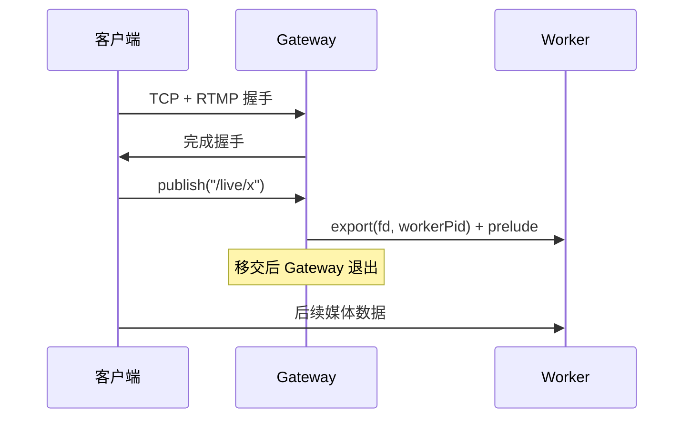

# 04. 被否决的方案（存档）

本文记录两条被放弃的路线及其**实测依据**，供后续参考，避免重复踩坑。

## 方案 A：socket 移交（技术可行，但因安全被否决）

### A.1 设计

Gateway 接收连接后，把 socket 文件描述符移交给 Worker 进程，媒体数据不经过 Gateway。



### A.2 技术验证：全部通过

| 测试项 | 结果 |
|---|---|
| `socket_wsaprotocol_info_import()` | ✅ 返回 `Socket` 对象 |
| `socket_export_stream()` | ✅ 转成 stream 资源 |
| 加入 `stream_select()` | ✅ `readable=1` |
| `fread` / `fwrite` | ✅ 双向正常 |
| `stream_socket_get_name()` | ✅ 拿到对端地址 |
| **交给 Workerman `TcpConnection`** | ✅ **能接管，`onMessage` 正常触发** |
| 父进程 export 后关闭原 socket | ✅ 子进程仍能读到已缓冲数据 |

完整链路实测输出：

```
PARENT: export => 'php_wsa_for_0'
PARENT: 关闭自己那份 socket
CHILD:  TcpConnection created
CHILD:  TcpConnection onMessage got 'rtmp-connect-publish'
PARENT: reply from child Workerman => 'handled-by-child-workerman'
```

失败可检测：

```
export 给 pid=1        => false
export 给 pid=99999999 => false
```

### A.3 否决原因：被安全软件判定为后门

```
ThreatName : VirTool:PHP/Remeshelsz.A
SeverityID : 5（严重）
检测次数    : 8
后果       : 文件内容被擦除为 99.9% 空白（大小不变，内容全空格）
```

触发特征组合：

```php
proc_open(PHP_BINARY . ' ... child')          // 自我复制、拉子进程
socket_wsaprotocol_info_export($sock, $pid)   // 句柄跨进程传递
@socket_read(...)                             // 大量 @ 抑制错误
```

这在静态特征上与 **PHP 反弹 shell** 高度重合。

**为什么不能靠白名单解决**：

- 客户服务器若启用同类 EDR，文件会被**静默擦除** → 服务起不来且无明显报错
- 金融/政务合规环境直接不可用
- 部署摩擦显著增加

详见 [appendix-antivirus.md](./appendix-antivirus.md)。

## 方案 B：Gateway 代理转发（安全，但架构不佳）

### B.1 设计

Gateway 与 Worker 之间建立普通 TCP 连接，双向转发字节。全流程只用 `stream_read` / `stream_write`。

### B.2 优点

- **无杀软风险**（纯普通 IO）
- 实现简单
- 跨平台一套代码

### B.3 否决原因：架构性缺陷

| 缺陷 | 说明 |
|---|---|
| **Gateway 成为带宽瓶颈** | 所有媒体流的两份拷贝都经过它，单进程 PHP 承受全部流量 |
| **播放与推流未解耦** | Worker 内仍同时处理推流和播放，播放慢会拖累推流 |
| **录像未解耦** | 录像写盘 IO 仍与推流同进程 |
| 多一跳延迟 | 同机 loopback，实测可接受，但不是主要问题 |

**核心问题**：方案 B 只解决了"连接如何分配"，没有解决"**不同职责的负载如何隔离**"。

播放慢拖垮推流、录像 IO 影响直播——这些真实问题依然存在。

## 三方案对比

| 维度 | A. socket 移交 | B. 代理转发 | C. 共享内存扇出（采用） |
|---|---|---|---|
| 杀软风险 | **高（已实测被拦）** | 无 | 无 |
| Gateway 是否承载媒体流量 | 否 | **是（瓶颈）** | 否 |
| 播放/录像是否隔离 | 是 | **否** | **是** |
| 连接是否需转移 | 是 | 否（反代） | **否（各进程自己收）** |
| 实现复杂度 | 中 | 低 | 中高 |
| 需要扩展 | `ext-sockets` | 无 | `ext-shmop` |
| 每帧开销 | 0 | 一次 read/write | 一次内存拷贝（0.025ms，可忽略） |
| 跨平台分叉 | 两套 | 无 | 无 |

## 为什么 C 更优

方案 C 同时满足三个条件，A 和 B 各自缺一条：

| 条件 | A | B | C |
|---|---|---|---|
| 不触发安全软件 | ❌ | ✅ | ✅ |
| 职责隔离（播放/录像不拖累推流） | ✅ | ❌ | ✅ |
| 无单点带宽瓶颈 | ✅ | ❌ | ✅ |

**C 的代价**是更高的实现复杂度（环形缓冲、掉队策略、关键帧回溯），这些在
[02-shared-memory.md](./02-shared-memory.md) 中列明了待设计项。

## 方案 C 的最终形态：推流池 + 播放池

方案 C 确定后，进一步用 `SO_REUSEPORT` 把推流和播放各自做成进程池。

**关键前提**：`SO_REUSEPORT` 让内核**随机**分配连接，因此推流与播放
必须监听**不同端口**，否则播放请求可能落到没有该路流的进程上。

| 池 | 端口 | 说明 |
|---|---|---|
| 推流池 | 1935 | 内核按端口做 reuseport 负载均衡 |
| 播放池 | 18080 | 同上 |

这样播放进程落在哪个实例都无所谓——帧从共享内存读，与推流进程位置无关。

详见 [01-process-model.md](./01-process-model.md)。

## 另一个被排除的思路：共享内存「替代」socket 移交

最初曾考虑"把 socket 字节写进共享内存让另一个进程继续用"。

**这是概念错误**：socket 是内核维护的连接状态（序号、窗口、缓冲），不是一段字节。
共享内存解决不了这个问题。

共享内存只能支撑"**帧数据**跨进程共享"，即方案 C 的思路。
