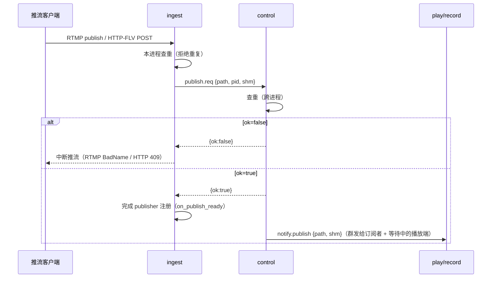
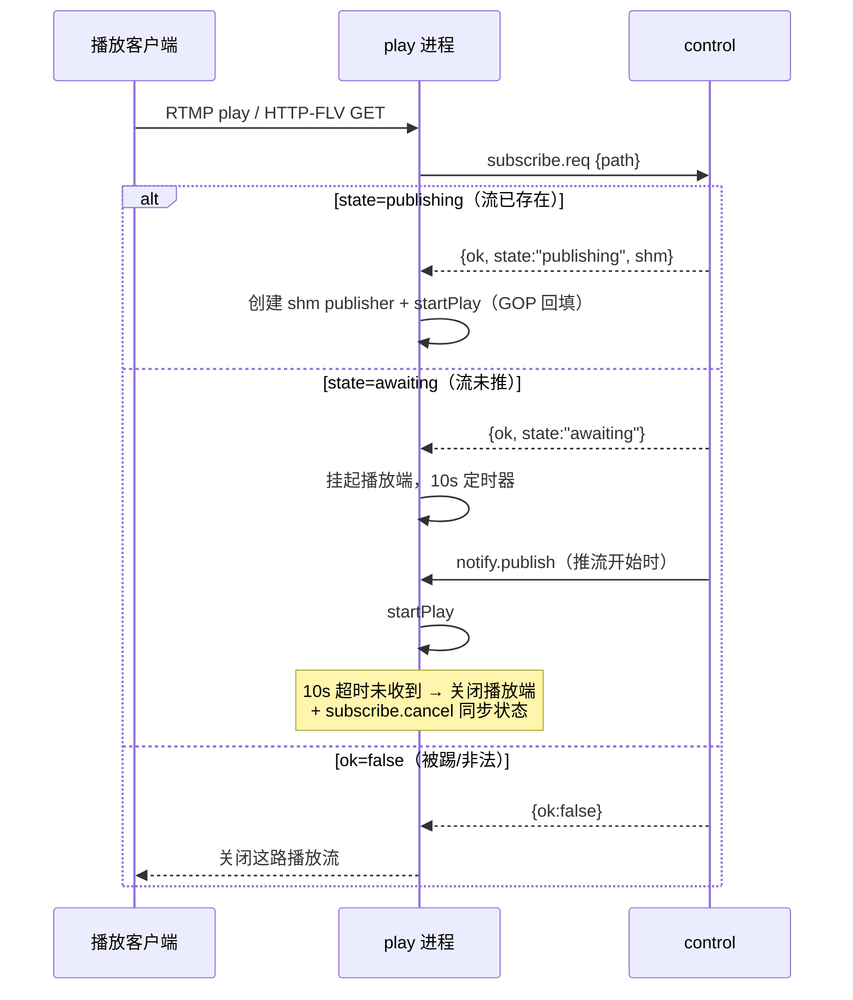
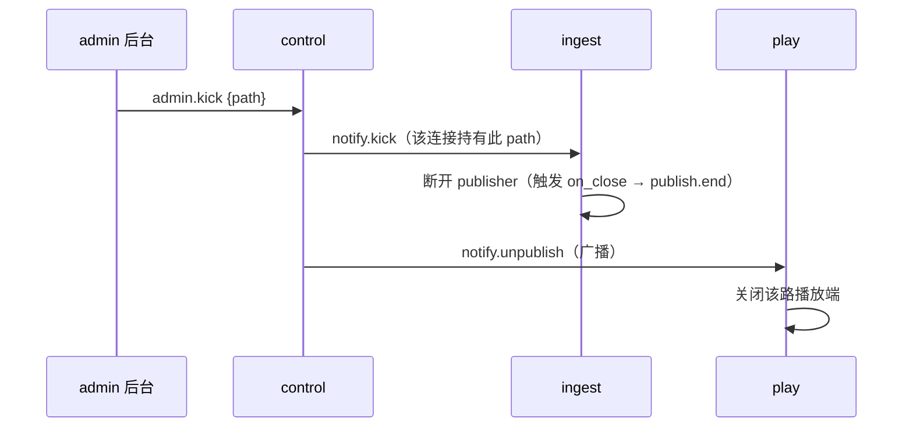

# 流注册表协议（Registry Protocol）v1

> control 进程是全局唯一的注册表 + 事件中心。**它是全局依赖，不允许挂**：
> 挂掉即整个多进程服务不可用（推流无法注册、播放无法发现流）。

## 1. 参与者

| 进程 | 角色 | 连接方式 |
|---|---|---|
| control | 注册表服务端 | 监听 `tcp://127.0.0.1:18090`（Windows）/ `unix://...`（Linux，同一协议） |
| ingest | 推流进程 | 主动连接 control，一条常驻命令连接 |
| play / record | 播放/录像进程 | 主动连接 control，一条常驻订阅连接 |
| admin | 管理后台 | 主动连接 control，短连接查询 |

所有消息为**换行分隔 JSON**（一行一条，支持粘包拆分）。

## 2. 消息封装

```jsonc
// 请求（客户端 → control，带自增序号 mid 关联回复）
{"mid": 1, "op": "publish.req", "path": "/live/x", ...}

// 回复（control → 客户端，回带相同 mid）
{"mid": 1, "ok": true, ...}

// 推送（control → 客户端，无 mid，op 以 notify. 开头）
{"op": "notify.publish", "path": "/live/x"}
```

客户端三类收发原语（`StreamRegistryClient`）：

| 原语 | 语义 | 实现要点 |
|---|---|---|
| `request(op, payload, onReply)` | 发送并等待返回（**异步等待**，不阻塞事件循环） | mid 关联 + 回调表 |
| `send(op, payload)` | 发送不等返回 | 直写 socket，失败缓存重发 |
| push 回调 | 接收 control 主动推送 | EV_READ → drain → 按 op 分发 |

## 3. 协议操作

### 3.1 ingest → control

| op | 载荷 | 回复 | 语义 |
|---|---|---|---|
| `publish.req` | `{path, pid, shm:{frameSlots, gopKb}}` | `{ok}` | **推流注册（必须等待返回）**。ok=false = 该流已在别处推流，ingest 必须中断本次推流 |
| `publish.end` | `{path}` | 无 | 推流结束（fire-and-forget），control 群发 `notify.unpublish` |
| `heartbeat` | `{paths:[...]}` | 无 | 5s 一次；刷新注册租约；超 15s 未续约视为 ingest 崩溃，control 清理并广播 unpublish |
| `stats.report` | `{role, data}` | 无 | 5s 一次；顺带刷新该 pid 所有流的租约 |

### 3.2 play/record → control

| op | 载荷 | 回复 | 语义 |
|---|---|---|---|
| `subscribe.req` | `{path}` | `{ok, state, shm?}` | **播放订阅（必须等待返回）**。`state=publishing`：流存在，立即开始刷 shm；`state=awaiting`：流还没推，等待 `notify.publish`；ok=false：被拒绝（踢出/非法），关闭这路播放 |
| `subscribe.cancel` | `{path}` | 无 | 播放在流开始前被关闭/超时，同步状态给 control |

`subscribe.ack` 的 `shm` 字段只在 `state=publishing` 时返回（frameSlots/gopKb，来自推流注册时的声明），播放端用它构造 shm 段访问参数。

### 3.3 control → play/record（推送）

| op | 载荷 | 语义 |
|---|---|---|
| `notify.publish` | `{path, shm}` | 等待中的播放端开始消费这路流（也广播给所有订阅者用于发现） |
| `notify.unpublish` | `{path}` | 流结束：播放端停止扇出、录像端 finalize |
| `notify.kick` | `{path, reason}` | 管理踢出：推流端断开该 publisher，播放端断开该路播放 |

### 3.4 admin → control

| op | 载荷 | 回复 |
|---|---|---|
| `admin.list` | — | `{paths:[...]}` |
| `admin.stats` | — | `{stats:{...}}`（各进程上报的聚合） |
| `admin.kick` | `{path}` | `{ok}`（control 向 owner 发 kick 并广播 unpublish） |

### 3.5 连接生命周期

- 建连后 control 先推一条 `notify.hello {paths:[...]}`（当前全量流列表，用于订阅端冷启动对齐）。
- 连接断开（play/record）→ 自动重连（1s 退避）→ 重连后 control 重发 `notify.hello`，客户端对齐状态。
- control 不主动断开业务连接；踢出走 `notify.kick` 由业务端自行断流。

## 4. 关键流程

### 4.1 推流建立



### 4.2 播放建立



### 4.3 刷帧（数据面，与注册表无关）

play/record 进程以固定间隔（默认 50ms）Timer 直接读各流 shm 段头 `writeSeq`，
连续读取未推送帧并扇出。**帧路径零消息传递**，帧延迟上界 = 刷帧间隔。

### 4.4 踢出



### 4.5 崩溃自愈

- ingest 崩溃：其流租约 15s 无 heartbeat → control 清理 + 广播 unpublish（播放端收尾、录像 finalize）。
- play/record 崩溃：重连后 control 重发 `notify.hello`，客户端重建状态。
- control 崩溃：全局不可用（设计取舍：不做降级，快速失败）。

## 5. 实现映射

| 协议角色 | 实现 |
|---|---|
| 服务端 | `StreamRegistryControl`（control 进程，`serve()` 启动） |
| 客户端 | `StreamRegistryClient`（request/send/push 三原语 + 自动重连） |
| ingest 接线 | `MediaServer::addPublishAsync()`（publish.req 等待 ack 后才完成注册） |
| play 接线 | `MediaServer::addPlayerAsync()`（subscribe.req → publishing/awaiting/rejected） |
| 数据面 | `SharedMemoryFrameBusConsumer`（50ms 刷帧）+ `SharedMemoryFrameBus`（单 GOP 段） |
| 持久化 | SQLite `record/registry.db`（1s 批量落盘，仅作 control 崩溃恢复） |
