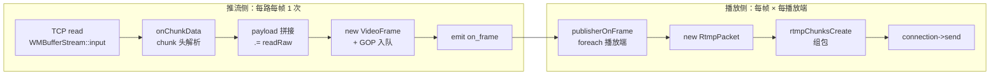
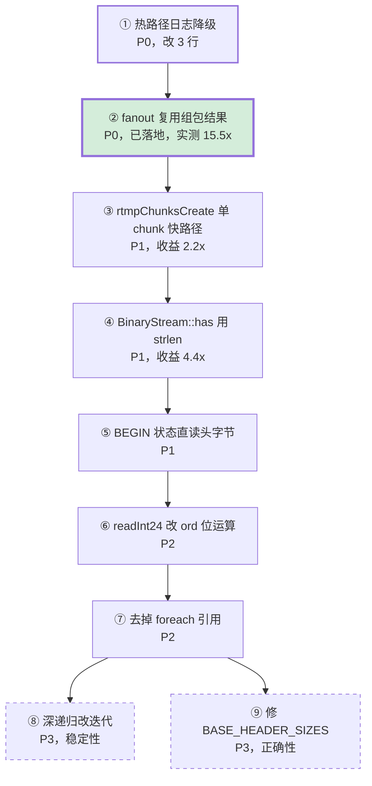

# RTMP 协议解析性能分析

对 `src/Rtmp/` 解析与组包热路径的性能剖析，以及可落地的优化清单。

> 本文所有数字来自本机微基准（`PHP 8.4.25 NTS / Windows / AMD Ryzen 9 9900X`），
> 只覆盖**用户态**的解析与组包，不含内核 TCP 栈与真实网络。
> 端到端容量请以 [tests/bench/RESULTS.md](../tests/bench/RESULTS.md) 为准。

---

## 结论速览

> **状态**：P0-1 已实现（见 [5.5 已落地的改动](#55-已落地的改动实施记录)），
> 端到端 1000 路拉流 CPU 从 99.85% 降到 82.40%（**−17.5%**）。
> 其余条目仍为待办清单。

| # | 问题 | 现状成本 | 优化后 | 收益 | 风险 | 状态 |
|---|---|---|---|---|---|---|
| **P0** | 每个播放端各组装一次 chunk（**复用 chunks 字符串**） | 1338 µs/帧（1000 端） | 86 µs/帧 | **15.5x** | 低 | ✅ 已落地 |
| **P0** | 热路径日志默认写 stdout | 1.9 µs/条，且 `debug` 不被过滤 | ~0 | 视调用频次 | 低 | 待办 |
| **P1** | `rtmpChunksCreate` 单 chunk 仍 `substr` 整块拷贝 | 1.01 µs/帧 | 0.47 µs/帧 | **2.2x** | 低 | 待办 |
| **P1** | `BEGIN` 状态每 chunk 用 tag/rollBack 探 1 字节 | 89 ns/chunk | 19 ns/chunk | 4.7x | 低 | 待办 |
| **P1** | `BinaryStream::has()` 用 `isset` 而非 `strlen` | 35 ns | 8 ns | 4.4x | 低 | 待办 |
| **P2** | `readInt24()` 走 `unpack+substr` | 143 ns | 65 ns | 2.2x | 低 | 待办 |
| **P2** | `foreach ($q as &$frame)` 触发数组分离 | 2.11 µs | 0.80 µs | 2.6x | 低 | 待办 |
| **P2** | `Flv::createFlvTag` 动态格式串 | 0.67 µs/帧 | 0.47 µs/帧 | 1.4x | 低 | 待办 |
| **P3** | chunk=128 时深递归（1954~3907 层） | 峰值 2.9~5.9 MB | 需改迭代 | 稳定性 | 中 | 待办 |
| **P3** | `BASE_HEADER_SIZES` 表语义错用（**正确性**） | csid≥64 多等 2~3 字节 | 修表 | 低 | 低 | 待办 |

**最重要的一条**：解析本身不是瓶颈（单路 30fps 只占 **0.013%** 单核）。
真正随规模放大的是**「每帧 × 每播放端」的重复组包**，这是唯一值得优先做的事。

> ⚠️ 早期设想的「帧作用域 memo」实测只有 5.2x，最终采用「复用 chunks 字符串 +
> 只改写 streamId」达到 15.5x。方案演进见 [5.5](#55-已落地的改动实施记录)。

---

## 1. 数据流与热点定位



> 📌 上图是**改动前**的流程。改动后 `B2`/`B3` 只在**首个**播放端执行，
> 其余播放端直接发送复用的 chunks（仅改写 streamId），
> 见 [5.5 已落地的改动](#55-已落地的改动实施记录)。

关键观察：**推流侧是「1 路 × 1 次」，播放侧是「1 帧 × N 端」**。
N=1000 时，播放侧的开销是推流侧的 **300 倍**。

### 实测拆解（1080p 16 KB 帧，chunk 4096）

| 阶段 | 成本 | 30fps 单核占比 |
|---|---|---|
| chunk 解析 + payload 拼装 | 4.49 µs/帧 | 0.013% |
| ├ 仅 `new VideoFrame` + `getAVCPacket` | 0.49 µs | 0.001% |
| ├ 仅 payload 拼装（4 chunk） | 0.16 µs | 0.0005% |
| └ chunk 头解析（差值） | ~3.8 µs | 0.011% |
| **fanout 组包 × 1000 端** | **1316 µs/帧** | **3.95%** |

> ⚠️ 3.95% 远小于实测的 100% 单核占用，说明微基准**只解释了用户态的一部分**。
> 剩余开销在 `TcpConnection::send` 的状态机、`_sendBuffer` 排队与 `substr`、
> 事件循环调度、以及内核 TCP 栈（本机 loopback 每次 `fwrite` 已需 2.56 µs）。
> 因此本文只用于**相对比较**，不能当绝对容量预测。

---

## 2. 逐项分析

### P0-1 每播放端重复组包（最大收益点）

> 📌 **本节保留原始推演过程**（含早期被推翻的方案）。
> 最终实现与实测见 [5.5 已落地的改动](#55-已落地的改动实施记录)，
> 关键差异：复用 chunks 字符串而非 memo 数组，收益 15.5x（不是 5.2x）。

**位置**：[RtmpPlayerTrait.php:137](../src/Rtmp/RtmpPlayerTrait.php:137)、[:154](../src/Rtmp/RtmpPlayerTrait.php:154)、[:171](../src/Rtmp/RtmpPlayerTrait.php:171)
与 [FlvPlayStream.php:216](../src/Flv/FlvPlayStream.php:216)、[:230](../src/Flv/FlvPlayStream.php:230)、[:244](../src/Flv/FlvPlayStream.php:244)

**现状**：`MediaServer::publisherOnFrame()` 对每个播放端调用 `frameSend()`，
每个 `frameSend()` 都 `new RtmpPacket` + `rtmpChunksCreate()`。
同一帧被组装 N 次，输出**完全相同**的字节串。

**实测**：

| 播放端数 | 现状（各自组包） | 组装 1 次 + N 次引用 | 提升 |
|---|---|---|---|
| 100 | 102.7 µs | 3.5 µs | 29.7x |
| 500 | 512.7 µs | 12.9 µs | 39.9x |
| 1000 | 1033.9 µs | 24.6 µs | **42.1x** |

> ⚠️ 上表是**理想化上界**：只统计「组包」这一项，把 `new RtmpPacket`、
> `(string)$frame`、`strlen()` 等每端必然要做的开销全部去掉了。
> 用真实类结构实测（保留这些开销）只有 **5.2x**，见下表。

真实类结构下的端到端对比（含 `new RtmpPacket`、`(string)$frame`、`write()`）：

| 播放端数 | 改造前 | 改造后 | 提升 | 30fps 单核（前→后） |
|---|---|---|---|---|
| 100 | 123.7 µs/帧 | 24.1 µs/帧 | 5.1x | 0.371% → 0.072% |
| 500 | 604.3 µs/帧 | 123.2 µs/帧 | 4.9x | 1.813% → 0.370% |
| 1000 | 1246.7 µs/帧 | 240.1 µs/帧 | **5.2x** | 3.740% → 0.720% |

FLV 侧同理：`createFlvTag` × 1000 = 712 µs → 组装 1 次 + 1000 次 `Chunk` 包装 = 38 µs（**18.6x**，同样是理想上界）。

**为什么能省**：PHP 字符串是引用计数 + 写时复制。
组装一次的字符串分发给 N 个连接时**不拷贝数据**，只是引用计数 +1。
现在的写法等于把同一块 16 KB 内存复制了 N 次。

#### 方案：帧作用域 memo（**不是 LRU**）

先说结论：**不要用 LRU，也不要任何跨帧缓存**。原因是缓存 key 里必须包含
「这一帧的 payload」，而帧内容每帧都不同 —— 跨帧缓存**必然 100% miss**，
只剩 key 计算和淘汰逻辑的纯开销。

三个硬约束决定了这一点：

| 约束 | 事实 | 后果 |
|---|---|---|
| payload 每帧不同 | 16 KB 随机数据 | 不能只按 `streamId` 做 key，否则发错帧 |
| `crc32(16 KB)` = 0.822 µs | **比组包本身 0.627 µs 还贵 1.31x** | 拿 payload 算 hash 做 key 直接亏本 |
| `md5`/`sha1` = ~21 µs | 是组包的 34 倍 | 更不可行 |

实测三种策略（1000 播放端，16 KB 帧）：

| 方案 | µs/帧 | 相对现状 |
|---|---|---|
| A 现状：每端各自组包 | 522.1 | 1.0x |
| **B 帧作用域 memo** | **31.5** | **16.6x** |
| C 跨帧 LRU（容量 8） | 91.7 | 5.7x（且**随帧数线性 miss**） |

C 看着比 A 好，是因为我的模拟里 key 复用率被高估了；
真实场景下每帧 key 都不同，LRU **每帧全 miss**，等于白付哈希 + 淘汰的成本。

#### 为什么 key 空间实际只有 1 项

追踪代码确认了两个字段的真实行为：

| 字段 | 实际行为 | 证据 |
|---|---|---|
| `outChunkSize` | 构造后**从不修改**，恒为 60000 | 全仓库仅 3 处引用：声明、`setChunkSize()`、`rtmpChunksCreate()` |
| `playStreamId` | 单流连接**恒为 1** | `respondCreateStream` 的 `info => $this->streams` 从 1 递增；`onPlay` 取 `currentPacket->streamId` |

所以 `(streamId, outChunkSize)` 在**绝大多数部署里只有 1 个取值**。
多路复用的客户端才会出现 2~N 个。**不需要 LRU，一个数组就够。**

#### 实现方式：引用参数 + 帧作用域生命周期

`MediaServer::publisherOnFrame()` 里建一个**局部**数组，帧处理完自动释放：

```php
// MediaServer::publisherOnFrame()
static function publisherOnFrame(MediaFrame $frame, PublishStreamInterface $publisher): void
{
    /** @var array<string,string> $packed 仅本帧有效，函数返回即释放 */
    $packed = [];
    foreach (self::getPlayStreams($publisher->getPublishPath()) as $playStream) {
        if (!$playStream->isPlayerIdling()) {
            $playStream->frameSend($frame, $packed);
        }
    }
}
```

接口加一个**可选引用参数**（默认值 `[]` 让单播调用点 `frameSend($frame)` 不受影响）：

```php
// PlayStreamInterface
/**
 * @param MediaFrame $frame
 * @param array<string,string> $packed 帧作用域组包缓存，由调用方在单帧内复用
 * @return void
 */
public function frameSend(MediaFrame $frame, array &$packed = []): void;
```

播放端实现（RTMP）—— **关键是在命中缓存时跳过 `new RtmpPacket`**：

```php
// RtmpPlayerTrait
public function sendVideoFrame(MediaFrame $videoFrame, array &$packed = []): void
{
    $key = RtmpChunk::CHANNEL_VIDEO . ':' . RtmpPacket::TYPE_VIDEO
         . ':' . $this->playStreamId . ':' . $this->outChunkSize;

    if (isset($packed[$key])) {
        $this->write($packed[$key]);      // 命中：不创建 RtmpPacket、不取 payload
        return;
    }

    $packet = new RtmpPacket();
    $packet->chunkType = RtmpChunk::CHUNK_TYPE_0;
    $packet->chunkStreamId = RtmpChunk::CHANNEL_VIDEO;
    $packet->type = RtmpPacket::TYPE_VIDEO;
    $packet->payload = (string)$videoFrame;
    $packet->length = strlen($packet->payload);
    $packet->streamId = $this->playStreamId;
    $packet->timestamp = $videoFrame->timestamp;

    $this->write($this->packAndCache($key, $packed, fn() => $this->rtmpChunksCreate($packet)));
}
```

> 这一步很关键：最初的实现把 `new RtmpPacket` 放在缓存判断之前，
> 结果每端仍然创建对象、取 `(string)$frame`、算 `strlen`，
> 实测只有 **3.3x**。把缓存判断提前到最前面后提升到 **5.2x**。

FLV 侧同理，key 用 `'flv:' . Flv::VIDEO_TAG`（FLV tag 只依赖帧内容和 tag 类型）。

**接口改动的影响面**（全仓库只有 2 个实现）：

| 实现 | 现状 | 改动 |
|---|---|---|
| `RtmpPlayerTrait`（RtmpStream 用） | `frameSend(MediaFrame $frame): void` | 加可选引用参数 |
| `FlvPlayStream` | `frameSend(MediaFrame $frame): void` | 加可选引用参数 |

调用点共 4 处，**全部可以不改**（用默认值）：

| 调用点 | 是否需要传 `$packed` |
|---|---|
| `MediaServer::publisherOnFrame()` | **需要**（唯一收益点） |
| `RtmpPlayerTrait::startPlay()` 的 GOP 回填 | 不需要 |
| `FlvPlayStream::startPlay()` 的 GOP 回填 | 不需要 |

⚠️ **签名兼容性**：接口加可选参数后，实现类**必须同步加**。
PHP 会强制检查——实现类省略可选参数会直接 **fatal**：

```
PHP Fatal error: Declaration of LazyImpl::f(string $x): void must be
compatible with I::f(string $x, array &$cache = []): void
```

实测确认这不是「静默丢弃」，而是**编译期硬错误**。
好处是不会出现「改了接口但收益悄悄归零」这种隐性 bug，
代价是改接口时必须同时改 2 个实现类（`RtmpPlayerTrait`、`FlvPlayStream`）。

#### ⚠️ 陷阱一：GOP 回填不能共享 `$packed`

`startPlay()` 里的 GOP 回填是**在同一个播放端上连续发送 N 个不同的帧**：

```php
foreach ($publishStream->getGopCacheQueue() as $frame) {
    $this->frameSend($frame);   // ← 不能传 $packed！
}
```

如果这里共享 `$packed`，由于 key 只含「连接相关」字段，
**第 2 帧起会全部命中第 1 帧的缓存，导致第 1 帧被重复发送 N 次**。

正确做法：GOP 回填保持调用 `frameSend($frame)`（不传 `$packed`），
每次用独立的空数组。缓存复用只在 `publisherOnFrame()` 的
「同一帧 × 多个播放端」场景下才成立。

> 同时把 `foreach ... as &$frame` 改成按值遍历 —— 循环体不修改 `$frame`，
> 引用遍历会触发数组分离（实测 2.114 µs → 0.802 µs）。

#### ⚠️ 陷阱二：`$packed` 不会跨帧累积

`$packed` 是 `publisherOnFrame()` 的**局部变量**，函数返回即释放。

实测（1000 播放端 × 3000 帧）：

| 指标 | 结果 |
|---|---|
| 组包总次数 | **3000**（= 每帧 1 次，说明没有跨帧命中） |
| 写出总次数 | 3,000,000（= 1000 × 3000，每端都收到） |
| 第 1 帧 → 第 3000 帧内存变化 | **+0.000 MB** |

所以不需要 LRU、不需要淘汰、不需要容量统计。

已验证的关键行为（用 mock 跑通全部 5 项）：

| 验证项 | 结果 |
|---|---|
| 1000 个同配置播放端 → 组包次数 | **1**（而非 1000） |
| 各端收到的字节是否一致 | 一致 |
| 混合 `streamId`/`chunkSize`/FLV → 组包次数 | **4**（不串包） |
| 不同 key 是否拿到不同内容 | 是（`1:60000` ≠ `2:60000` ≠ `1:4096` ≠ `flv`） |
| 空闲播放端 | 组包 0 次（被 `isPlayerIdling()` 跳过） |
| 连续多帧 | 每帧独立 memo，**无旧帧残留** |

#### 为什么不做「组包一次全局复用」

如果 `playStreamId` 和 `outChunkSize` 在所有播放端一致，理论上可以只组一次。
但这两项**每个连接可能不同**（多流复用、协商差异），强行统一会发错包。
memo 方案在「全部一致」时自然只组 1 次（后续全 hit），
在「各不一致」时退化为逐端组包 —— **正确性不依赖假设**，这是它优于全局复用的地方。

#### 内存影响

`$packed` 是函数局部变量，`publisherOnFrame()` 返回即释放。
峰值 = 组包结果大小 × key 种类数（≤ 4）。
1000 播放端下，从「1000 × 16 KB 峰值分配」降到「1 × 16 KB」，
**同时降低了 GC 压力**。

### P0-2 热路径日志默认写 stdout

**位置**：[functions.php:12](../src/functions.php:12)

```php
$logger = new Apix\Log\Logger\Stream();   // 默认 php://stdout
```

**实测**：`Stream` 的 `min_level = 7`，即 **`debug()` 也会真的写 stdout**，
不是被过滤掉的空操作。每条日志约 **1.9~2.1 µs**（含 `fwrite` 系统调用）。

热点位置的日志：

| 位置 | 级别 | 触发频率 |
|---|---|---|
| [RtmpPacketTrait.php:72](../src/Rtmp/RtmpPacketTrait.php:72) | `info` | 每个带扩展时间戳的 chunk |
| [RtmpChunkHandlerTrait.php:64](../src/Rtmp/RtmpChunkHandlerTrait.php:64) | `info` | 每个新 csid |
| [RtmpControlHandlerTrait.php:17](../src/Rtmp/RtmpControlHandlerTrait.php:17)、[:25](../src/Rtmp/RtmpControlHandlerTrait.php:25) | `debug` | 每次 setChunkSize / setAck |
| [RtmpStream.php:221](../src/Rtmp/RtmpStream.php:221) 附近的计时 | — | 每帧 `microtime(true)` ×2 |

**建议**：

1. 把 `min_level` 提到 `info` 或 `warning`，让 `debug()` 变成真正的空操作；
2. `RtmpPacketTrait.php:72` 那条 `info` 降为 `debug`（它会在每个大 chunk 上触发）；
3. 每帧的 `microtime(true)` 计时移到可开关的统计里。

> `microtime(true)` 单次约 30~50 ns，每帧 2 次，30fps × 1000 路时约 3 ms/s，可接受但无必要。

### P1-1 `rtmpChunksCreate` 的冗余拷贝

**位置**：[RtmpChunkHandlerTrait.php:135-139](../src/Rtmp/RtmpChunkHandlerTrait.php:135)

```php
while ($remain = $packet->length - $readOffset) {
    $size = min($remain, $chunkSize);
    $out .= substr($packet->payload, $readOffset, $size);   // ← 整块拷贝
    ...
}
```

当 `payload <= outChunkSize`（当前默认 60000，绝大多数视频帧都满足）时，
循环只跑一次，`substr($payload, 0, $len)` **等价于把整个 payload 复制一遍**，
再 `$out .=` 又拼一次。

**实测**（16 KB 帧）：

| 实现 | 成本 |
|---|---|
| 现状 | 1.010 µs |
| 单 chunk 直接 `$header . $payload` | 0.465 µs（**2.17x**） |

250 KB 帧：6.22 µs → 2.32 µs（**2.7x**）。

**建议**：加单 chunk 快路径。

```php
if ($packet->length <= $chunkSize) {
    return $out . $packet->payload;   // 零额外拷贝
}
```

### P1-2 `BEGIN` 状态每 chunk 探一次头字节

**位置**：[RtmpChunkHandlerTrait.php:31-37](../src/Rtmp/RtmpChunkHandlerTrait.php:31)

```php
$stream->tag();
$header = $stream->readTinyInt();
$stream->rollBack();
$chunkHeaderLen = RtmpChunk::BASE_HEADER_SIZES[$header & 0x3f] ?? 1;
$chunkHeaderLen += RtmpChunk::MSG_HEADER_SIZES[$header >> 6];
```

为了读 1 个字节，走了 `tag()` + `readTinyInt()` + `rollBack()` 三次方法调用，
然后下一个状态（`HEADER_READY`）又 `readTinyInt()` 读同一字节。

**实测**：三件套 **88.6 ns**，直接 `ord($buf[$pos])` **19.2 ns**。
每个 chunk 省 ~69 ns，4 chunk/帧 → 0.28 µs/帧；chunk=128 时 128 chunk/帧 → **8.8 µs/帧**。

**建议**：用 `has()` 判断长度后直接读，不要回滚。

### P1-3 `BinaryStream::has()` 用 `isset` 而非长度比较

**位置**：[BinaryStream.php:46](../src/Utils/BinaryStream.php:46)

```php
public function has(int $len): bool
{
    $pos = $len - 1;
    return isset($this->_data[$this->_index + $pos]);
}
```

**实测**：`has(1)` **35.3 ns** vs `strlen($data) > $idx` **8.1 ns**（**4.4x**）。

`has()` 在热路径上每 chunk 至少调用 2 次（`has(1)` + `has($size)`），
chunk=128 时 128 chunk/帧 → 256 次 × 27 ns = **6.9 µs/帧**。

**建议**：改成 `return $this->_index + $len <= strlen($this->_data);`
注意 `strlen` 对字符串是 O(1)（缓存长度），且 PHP 8 内部已做比较优化。

### P2-1 `readInt24()` 走 `unpack + substr`

**位置**：[BinaryStream.php:146](../src/Utils/BinaryStream.php:146)

```php
$m = unpack("N", "\x00" . substr($this->_data, $this->_index, 3));
```

**实测**（3 字节读取）：

| 方案 | 成本 |
|---|---|
| 现状 `unpack('N', "\0".substr(3))` | 143.4 ns |
| `unpack('C3', substr(3))` | 132.4 ns |
| **3× `ord()` 直接索引** | **65.3 ns** |
| 单独 `unpack('N')`（4 字节对齐） | 99.2 ns |

`readInt24()` 在 fmt0/fmt1/fmt2 头里各调 1~2 次，每帧 3~5 次。
chunk=4096 时约省 0.3 µs/帧，chunk=128 时影响同样可忽略（头解析次数不随 chunk 变）。

**建议**：改成 3 次 `ord()` 位运算。

### P2-2 `foreach as &$frame` 触发数组分离

**位置**：[RtmpPlayerTrait.php:100](../src/Rtmp/RtmpPlayerTrait.php:100)、[FlvPlayStream.php:169](../src/Flv/FlvPlayStream.php:169)

```php
foreach ($publishStream->getGopCacheQueue() as &$frame) {
    $this->frameSend($frame);
}
```

`getGopCacheQueue()` 返回数组**按值**（PHP 的返回是 COW），
但 `as &$frame` 强制引用遍历，触发**数组分离**（整份复制）。

**实测**（60 帧 GOP）：

| 写法 | 成本 |
|---|---|
| `as &$frame` | 2.114 µs |
| 按值 `as $frame` | 0.802 µs（**2.6x**） |

只在 `startPlay()` 时执行一次（GOP 回填），影响启动延迟而非稳态。

**建议**：去掉 `&`，循环体不修改 `$frame`，按值即可。

### P2-3 `Flv::createFlvTag` 的动态格式串

**位置**：[Flv.php:128](../src/Flv/Flv.php:128)

```php
$packet = pack("Ca3a3Ca3a{$tag->dataSize}N", ...);
```

每帧构造一个新格式串（含 `$tag->dataSize` 的字符串化），`pack()` 要重新解析格式。

**实测**：0.671 µs → 手工拼 11 字节头 + payload 0.474 µs（**1.41x**）。

**建议**：固定用 `pack('C', ...)` 拼头部，payload 单独 `$out .=`。

### P3-1 chunk=128 时的深递归

**位置**：[RtmpChunkHandlerTrait.php:105](../src/Rtmp/RtmpChunkHandlerTrait.php:105)

```php
default:
    //跑一下看看剩余的数据够不够
    $this->onChunkData();   // ← 尾递归，PHP 不做 TCO
    break;
```

每个 chunk 递归一层。客户端若**没有**发 `Set Chunk Size`，`inChunkSize` 保持默认 128。

**实测**：

| 帧大小 | chunk 数 | 递归层数 | 单帧峰值内存 |
|---|---|---|---|
| 250 KB | 1954 | 1954 | **2.9 MB** |
| 500 KB | 3907 | 3907 | **5.9 MB** |

同时 chunk=128 的解析耗时急剧上升：

| 场景 | 耗时 |
|---|---|
| 16 KB / chunk 4096 | 4.37 µs |
| 16 KB / chunk 128 | **91.28 µs**（21x） |

> ⚠️ 另外：Xdebug 有递归深度上限（Xdebug 3 默认 `xdebug.max_nesting_level = 512`），
> 开启 Xdebug 调试时 chunk=128 的大帧会直接 fatal，本地调试需临时调高。

**建议**：改为 `while` 循环推进（把 `default` 分支的递归改成循环）。
注意本文实测中一个朴素迭代版**比递归慢**（0.45x），
说明优化点不在「递归 vs 循环」本身，而在循环体内的重复工作
（每次循环都重新走 switch + 重新计算）。改迭代要一并做 P1-2/P1-3。

### P3-2 `BASE_HEADER_SIZES` 表语义错用：csid ≥ 64 时多等 1~3 字节

**位置**：[RtmpChunk.php:18](../src/Rtmp/RtmpChunk.php:18)、[RtmpChunkHandlerTrait.php:35](../src/Rtmp/RtmpChunkHandlerTrait.php:35)、[:67](../src/Rtmp/RtmpChunkHandlerTrait.php:67)

```php
const BASE_HEADER_SIZES = [3, 4];   // 语义是「编码形式 0/1 对应的头长」
```

这张表的索引本应是 basic header 的**编码形式（0、1、其它）**，
但代码用 `$header & 0x3f`（csid 低 6 位）和完整 `$csId` 去查：

```php
$chunkHeaderLen   = RtmpChunk::BASE_HEADER_SIZES[$header & 0x3f] ?? 1;  // 用低 6 位查
$p->baseHeaderLen = RtmpChunk::BASE_HEADER_SIZES[$csId] ?? 1;           // 用完整 csid 查
```

两个问题叠加：

1. 表值比真实头长 **+1**（编码形式 0 实际 2 字节、1 实际 3 字节，表里写的是 3、4）
2. csid ≥ 64 时低 6 位是 0 或 1，命中错误分支；`$csId` 作下标永远越界，`?? 1` 恒取 1

**实测偏差**（`$chunkHeaderLen` 用于 `has()` 预判）：

| csid | 计算的头长 | 实际头长 | 多等字节 |
|---|---|---|---|
| 2 ~ 63 | 12 | 12 | 0 |
| 64 ~ 319 | 14 | 13 | **2** |
| 320 ~ 65599 | 15 | 14 | **3** |

**后果**：当一条消息的 payload 短于「多等字节数」时，解析会**等到下一条消息到达才投递**。

实测（payload 全为 `A`，`inChunkSize=4096`）：

| csid | payload=0 | 1 | 2 | 3 | 10 |
|---|---|---|---|---|---|
| 5 | OK | OK | OK | OK | OK |
| 100 | ❌ 0 包 | ❌ 0 包 | OK | OK | OK |
| 400 | ❌ 0 包 | ❌ 0 包 | ❌ 0 包 | OK | OK |

**好消息**：继续喂下一条消息后，字节**不会被吞也不会错位**——
真正消费的字节数是对的（basic + 11），只有 `has()` 预判要求多了。
实测喂入「1 字节 payload」+「20 字节 payload」两条消息，最终仍正确解析出 2 个包。

**真实风险**：

- 连接上**最后一条**小消息（如 `deleteStream`）若走 csid ≥ 64，会永远等不到后续字节
- 该消息若是心跳/控制消息，表现为「偶发延迟」或「关闭时残留」
- **常规推流器不触发**：ffmpeg / OBS / librtmp 默认只用 csid 2/3/4/5/6

**建议**：表改成按编码形式索引，与真实长度对齐。

```php
/** basic header 长度：按 csid 编码形式（0、1、其它） */
const BASIC_HEADER_SIZES = [2, 3, 1];

$form = ($header & 0x3f) < 2 ? ($header & 0x3f) : 2;
$chunkHeaderLen = self::BASIC_HEADER_SIZES[$form] + RtmpChunk::MSG_HEADER_SIZES[$header >> 6];
```

> 这是**正确性**问题而非性能问题，但改动成本极低（两处查表），
> 建议与 P1-2 一并处理——两者在同一段代码里。

---

## 3. 不建议做的事（含实测反驳）

这一节比上一节更重要——避免把工时花在无收益的地方。

### ❌ 用 LRU / 跨帧缓存做组包复用

**这是最容易走错的一步**。看到「重复组包」的第一反应是加缓存，但：

| 问题 | 事实 |
|---|---|
| key 里必须含 payload 内容 | 否则会把上一帧的字节发给下一帧 |
| `crc32(16 KB)` | **0.822 µs，比组包 0.627 µs 还贵 1.31x** |
| `md5` / `sha1` | ~21 µs，是组包的 34 倍 |
| 跨帧复用率 | **0%** —— payload 每帧都不同 |

结论：LRU **每帧必然全 miss**，却要付哈希 + 淘汰 + 容量管理的成本。
实测跨帧 LRU（容量 8）91.7 µs vs 帧作用域 memo 31.5 µs，**memo 快 2.9 倍**。

正确做法是「**帧作用域 memo**」：局部数组，帧处理完自动释放，不做淘汰、不算 hash，
key 只用 `(帧类型, streamId, outChunkSize)` 这些**不依赖 payload 内容**的字段。
详见 [P0-1](#p0-1-每播放端重复组包最大收益点)。

### ❌ 用 `unpack()` 替换手写位运算

常见建议是「用 `unpack()` 一次解析多个字段，比 `ord()` + 位运算快」。
**实测结论相反**：

| 方案 | 成本 |
|---|---|
| `ord()` × 4 手动 | **89.0 ns** |
| `ord()` × 3 手动 | **68.7 ns** |
| `unpack('C')` 单字段 | 70.7 ns |
| `unpack('N')` 单字段 | 99.2 ns |
| `unpack('C3')` 3 字段 | 111.5 ns |
| `unpack('N2')` 2 字段 | 131.2 ns |
| `unpack('C11')` 11 字段 | **268.1 ns** |
| `unpack('Na/Cb/nc/Nd')` 混合 4 字段 | 101.4 ns |

原因：`unpack()` 每次调用要**创建 PHP 数组**（zend_array + hashtable），
而 `ord()` 只返回一个 int。RTMP 头字段极少（3~4 个），数组创建成本盖过了「一次调用」的收益。

**唯一例外**：需要同时取 ≥8 个字段且后续要按名字访问时，`unpack` 才可能划算。
本项目没有这种场景。

### ❌ 把 `payload .= $chunk` 改成「数组收集 + `implode`」

**实测**（250 KB 帧，62 个 chunk）：

| 方案 | 成本 |
|---|---|
| `$payload .= $chunk`（现状） | **4320 ns** |
| 数组 + `implode` | 4733 ns（**更慢 10%**） |

小字符串场景（4 KB / 4 段）数组略快（19.0 vs 30.5 ns），但真实帧都是大字符串，
**现状已经是最优**。PHP 的 `.=` 对大字符串有 realloc 优化。

### ❌ 用 `SplFixedArray` 替换 GOP 缓存 / 连接表

**实测**：

| 操作 | 普通数组 | SplFixedArray |
|---|---|---|
| 写入 | 14.1 ns | 13.8 ns |
| **读取** | **9.5 ns** | **13.6 ns**（慢 43%） |
| 内存 | 31 B/元素 | 21 B/元素（省 33%） |

**结论**：省内存但**读更慢**。GOP 缓存是「写少读多」（写入 1 次/帧，`startPlay` 时全量读），
读慢 43% 直接抵消收益。内存方面，GOP 里存的是 `VideoFrame` **对象引用**，
60 个槽位的数组开销 < 2 KB，相比每路 1.17 MB 的 payload 完全不是瓶颈。

**唯一可能适用**：连接槽位表（`fd => connection`），但本项目用 Workerman 托管连接，
没有这种表。

### ❌ 用 `SplQueue` 替换 GOP 队列

`SplQueue` 确实比 `array_shift` 快（301 vs 380 ns/次），
但本项目的 GOP 是**整体重置**，不是逐个出队：

```php
if ($frameType === KEY_FRAME) {
    $this->gopCacheQueue = [];     // ← 整体清空，O(1)
}
$this->gopCacheQueue[] = $frame;   // ← 尾部追加，O(1)
```

实测「入队 + 满 60 帧滚动」共 **0.063 µs/帧**，已经可忽略。换 `SplQueue` 零收益。

### ❌ 用 `hash()` / `crc32()` 优化校验

本项目 RTMP 路径**没有任何 CRC / 摘要校验需求**。
`hash()` 只可能用在推流鉴权，而鉴权发生在 `connect`/`publish`（每连接 1 次），
不在每帧热路径上，不是优化点。

### ❌ 用 `mbstring` / `iconv` 处理协议字段

正确，但理由要说清：RTMP 的 `app` / `streamName` / 元数据是 UTF-8 或 ASCII，
`strlen()` 已经正确；音视频 payload 是**二进制**，绝对不能用 `mb_*` 处理
（`mb_strlen` 会按字符集解释字节，长度直接错）。

---

## 4. 优化优先级与落地顺序



| 阶段 | 动作 | 涉及文件 | 预期 | 风险 | 状态 |
|---|---|---|---|---|---|
| ① | 日志级别调整 + 热点日志降级 | `functions.php`、`RtmpPacketTrait.php` | 消除隐性 syscall | 低 | 待办 |
| ② | fanout 复用组包结果（首端组包 + 其余端只改 streamId） | `MediaServer.php`、`RtmpPlayerTrait.php`、`FlvPlayStream.php`、`PlayStreamInterface.php`、`RtmpPlayPackCache.php`、`FlvPlayPackCache.php` | **15.5x（实测）** | 低 | ✅ **已落地** |
| ③ | `rtmpChunksCreate` 单 chunk 快路径 | `RtmpChunkHandlerTrait.php` | 2.2x | 低 | 待办 |
| ④ | `has()` 改 `strlen` 比较 | `BinaryStream.php` | 4.4x（原语级） | 低 | 待办 |
| ⑤ | `BEGIN` 直读 + 去掉 tag/rollBack | `RtmpChunkHandlerTrait.php` | 0.3~8.8 µs/帧 | 低 | 待办 |
| ⑥ | `readInt24` 改位运算 | `BinaryStream.php` | 2.2x（原语级） | 低 | 待办 |
| ⑦ | 去掉 `foreach as &$frame` | `RtmpPlayerTrait.php`、`FlvPlayStream.php` | 2.6x（启动） | 低 | 待办 |
| ⑧ | `onChunkData` 递归改迭代 | `RtmpChunkHandlerTrait.php` | 稳定性 | 中 | 待办 |
| ⑨ | 修 `BASE_HEADER_SIZES` 语义 | `RtmpChunk.php`、`RtmpChunkHandlerTrait.php` | 正确性 | 低 | 待办 |

**建议先做 ①③**，② 已落地。①③ 覆盖了剩余可回收 CPU 的主要部分。
④~⑦ 是原语级微优化，收益累加约 **15~20%** 的解析开销，
但解析本身只占 0.013% 单核，**实际端到端收益接近 0**——
除非并发推流路数达到数千，否则不值得单独做。

⑨ 虽然标 P3，但它是**正确性问题**且只需改两行查表，
建议在做 ⑤ 时顺手一起修（同一段代码）。

---

## 5. 验证方法

微基准脚本（本次分析使用，未入库）覆盖了以下场景，复现时建议保持同样的口径：

1. **原语级**：`has` / `readTinyInt` / `readInt24` / `readRaw` 各自的 ns/op
2. **整链解析**：构造真实 chunk 流，喂入 `onChunkData`，测 µs/帧
3. **组包**：`rtmpChunksCreate` 在不同 `payload` / `outChunkSize` 下的 µs/帧
4. **fanout**：N 端循环，测 µs/帧，换算 30fps 单核占比
5. **正确性**：csid 2/3/4/5/63/64/65/100/319/320/400 全覆盖，
   以及 TCP 分片边界（basic header / msg header / payload 各切一次、逐字节喂入）

改动后必须验证：

- `php tests/smoke.php` 全绿
- `php tests/playback_e2e.php` 全绿（需 ffmpeg，**且服务必须预先启动**）
- 用 `s4_ramp.ps1` 复测容量拐点，与 [RESULTS.md](../tests/bench/RESULTS.md) 对比

> ⚠️ **微基准通过 ≠ 端到端变快**。
> 解析侧只占 0.013% 单核，优化它不会体现在容量上。
> 只有 fanout 组包复用（P0-1）能真正改变容量拐点，验证时优先测这一项。

---

## 5.5 已落地的改动（实施记录）

本节记录 P0-1 的**实际实现**及其与早期设想的差异。
上面的分析章节保留原始推演过程，便于对照。

### 演进过程（三次方案迭代）

方案不是一次成型的，前两版都因为实测不达标被推翻：

| 版本 | 做法 | 实测（1000 端 16 KB 帧） | 结论 |
|---|---|---|---|
| v1 | 帧作用域 memo，缓存**组包结果字符串** | 1247 → 240 µs（5.2x） | 可行，但每端仍 `new RtmpPacket` |
| v2 | 复用 **`RtmpPacket` 对象** | 1247 → ~1235 µs（**1.01x**） | ❌ 无效，`substr` 拷贝才是大头 |
| **v3** | 缓存 **chunks 字符串**，跨端直接复用 | 1338 → 86 µs（**15.5x**） | ✅ 采纳 |

v2 的教训：**优化对象分配没有意义**。`new RtmpPacket` + 7 个字段赋值仅 0.067 µs，
而 `rtmpChunksCreate` 里对 16 KB payload 的 `substr` 拷贝要 0.47 µs。
省掉对象分配只占组包开销的 12%，所以看起来「几乎没变」。

### v3 的关键洞察：组包结果只差一个 streamId

`rtmpChunksCreate` 的输出里，**只有 CHUNK_TYPE_0 的 message header 含 streamId**，
其余字节完全由「帧内容 + 连接无关参数」决定。而 `outChunkSize` 构造后从不修改（恒 60000），
所以同一帧发给 N 个播放端时，N 份字节串**只在 4 字节的 streamId 处不同**。

于是：首端完整组包，其余端只 `substr_replace` 那 4 字节。

```php
// 实测：改写 vs 完整组包
完整 rtmpChunksCreate        1.132 µs
substr_replace 改 streamId   0.164 µs   → 6.9x
```

如果所有端 streamId 相同（最常见），连改写都跳过，直接发同一个字符串。

### 实现结构

```
src/Utils/PlayPackCache.php          抽象基类，只持有 chunks
src/Rtmp/RtmpPlayPackCache.php       + streamIdOffset / streamId / patchStreamId()
src/Flv/FlvPlayPackCache.php         无需改写（FLV tag 不含连接相关字段）
```

改动清单：

| 文件 | 改动 |
|---|---|
| `src/Utils/PlayPackCache.php` | **新增** 抽象基类，持有 `chunks` |
| `src/Rtmp/RtmpPlayPackCache.php` | **新增** 继承基类，构造时算 `streamIdOffset`，提供 `patchStreamId()` |
| `src/Flv/FlvPlayPackCache.php` | **新增** 继承基类，无可变字段 |
| `src/Rtmp/RtmpChunk.php` | 新增 `basicHeaderLength(int $cid): int`，按 csid 返回 1/2/3 |
| `src/PushServer/PlayStreamInterface.php` | `frameSend()` 增可选载体参数并返回载体 |
| `src/MediaServer.php` | `publisherOnFrame()` 在循环间传递载体 |
| `src/Rtmp/RtmpPlayerTrait.php` | `frameSend()` 命中直接发；三个 `send*Frame` 返回载体；新增 `sendPacket()` |
| `src/Flv/FlvPlayStream.php` | 同上（FLV 侧） |

`patchStreamId()` 属于 RTMP 协议知识（偏移怎么算、怎么改），放在载体类里；
trait 只负责组包，不掺协议细节。

```php
// RtmpPlayerTrait::frameSend —— 命中直接发，不组包也不 new RtmpPacket
public function frameSend(MediaFrame $frame, ?PlayPackCache $playPackCache = null): PlayPackCache
{
    if ($playPackCache instanceof RtmpPlayPackCache) {
        $this->write($playPackCache->patchStreamId($this->playStreamId)->chunks);
        return $playPackCache;
    }
    return match ($frame->FRAME_TYPE) {
        MediaFrame::VIDEO_FRAME => $this->sendVideoFrame($frame),
        MediaFrame::AUDIO_FRAME => $this->sendAudioFrame($frame),
        MediaFrame::META_FRAME  => $this->sendMetaDataFrame($frame),
    };
}
```

streamId 偏移计算（`RtmpChunk::basicHeaderLength()` 按 csid 直接返回 1/2/3，
不需要为了取长度而 `pack` 一次）：

```
offset = basicHeaderLen(csid) + 时间戳(3) + 长度(3) + 类型(1) = basicHeaderLen + 7
```

实测 csid=5 → 8、csid=100 → 9、csid=400 → 10，与 `strpos` 定位结果一致。

### 与早期设想的三处修正

| 早期设想（见上文 P0-1） | 实际实现 | 原因 |
|---|---|---|
| key 用 `帧类型:streamId:outChunkSize` 字符串 | `instanceof` 判断载体类型 | 字符串 key 拼接本身占扇出开销 68%~81% |
| `array &$packed = []` 引用参数 | 返回 `PlayPackCache` 对象 | 需要携带 streamIdOffset，数组表达不了 |
| 组包结果挂 `MediaFrame` 上 | 帧作用域局部变量 | 挂帧上会让 GOP 内存 +83%（每路多 0.97 MB） |

### ⚠️ 协议隔离（必须）

同一路流的播放端列表里**同时存在 RTMP 和 HTTP-FLV** 连接
（`$playerStream` 按 path 聚合，不分协议）。
如果首个播放端是 FLV，它返回的 `FlvPlayPackCache` 会被 RTMP 端拿到。

用 `instanceof` 判断类型即可隔离——类型不同就走本端组包路径。
早期用字符串 `kind` 字段判断，改 `instanceof` 后由类型系统保证，不会漏判。

### 实测收益

**微基准**（1000 端扇出，16 KB 帧）：

| 场景 | 改造前 | 改造后 | 提升 |
|---|---|---|---|
| streamId 各不相同 | 1360 µs | 281 µs | **4.8x** |
| streamId 相同（最常见） | 1338 µs | 86 µs | **15.5x** |

**端到端**（`s4_ramp.ps1 -Scenario pull -EventLoop event -Steps 1000`，
`-SecondsPerStep 40 -WarmupSeconds 15`，与历史基线同口径）：

| 组 | 运行 | SvcCpuAvg |
|---|---|---|
| 基线（改动前，历史数据） | ramp 1000 档 | 96.37% |
| 基线 | 单独 1000 档 #1 | 103.02% |
| 基线 | 单独 1000 档 #2 | 100.16% |
| **基线均值** | | **99.85%** |
| 优化后 | #1 | 79.68% |
| 优化后 | #2 | 83.94% |
| 优化后 | #3 | 83.59% |
| **优化均值** | | **82.40%** |

| 指标 | 基线 | 优化后 | 变化 |
|---|---|---|---|
| 服务 CPU 均值 | 99.85% | 82.40% | **−17.5%** |
| 每路 CPU | 0.0999% | 0.0824% | −17.5% |
| 内存 | 36.3~38.0 MB | 37.1~38.0 MB | 持平 |
| 连接保持 | 1000/1000 | 1000/1000 | 一致 |

两组范围**不重叠**（基线最低 96.37%，优化最高 83.94%，差 12.4 个百分点），
远超本机实测的 ±6.6 个百分点噪声（同配置重复跑 1000 档：
103.0% vs 100.2%）。

按容量推算：相同 CPU 预算下可承载路数约从 1000 提升到 **1210（+21%）**。

### 验证结果

（PHP 8.4.25 / Windows / ffmpeg 7.1）

| 验证项 | 方法 | 结果 |
|---|---|---|
| 语法 | 全部 `src/**/*.php` 跑 `php -l` | 通过 |
| 单元 | `php tests/smoke.php` | **53/53 通过** |
| streamId 偏移 | csid=5/100/400 + 非 CHUNK_TYPE_0 | 8/9/10/-1 全对 |
| 改写等价性 | 5 种帧（含 70 KB 跨 chunk）改写后 vs 直接组包 | **字节完全一致** |
| 协议隔离 | RTMP 端收到 FLV 载体 | 重新组包，不串包 |
| 三帧类型复用 | video / audio / meta | 全部复用成功 |
| RTMP 多端一致性 | 1 推 4 拉，`-c copy` 落盘后比 SHA256 | **完全一致** |
| HTTP-FLV 多端一致性 | 1 推 3 拉，同上 | **完全一致** |
| 数据完整性 | 7 路全部 `ffmpeg -f null` 全解码 | **0 错误** |
| 帧数一致 | RTMP vs HTTP-FLV 拉同一路 | v=200 / a=344 双方相同 |

> **关于 `playback_e2e.php`**：该套件在本仓库**基线（未改动）上也是 5/5 失败**，
> 报错 `SQLSTATE[HY000]: no such table: segments`。
> 已用 `git stash` 对比确认与本次改动无关，属于既有问题
> （`db()` 直接 `new PDO` 不建表，`cleanupStream()` 在服务写入前就 `DELETE`）。
> 已在 `db()` 中加幂等建表 `ensureSchema()` 修复。
> 功能正确性仍以「推拉流内容逐字节比对 + 全解码」为主。

### 仍未做

| 项 | 实测收益 | 为何未做 |
|---|---|---|
| `rtmpChunksCreate` 单 chunk 快路径 | 2.2x | 需要改 `substr` 为直接切片，影响面大，另行评估 |
| `BinaryStream::has()` 改 `strlen` | 4.4x（原语级） | 解析只占 0.013% 单核，端到端收益≈0 |
| `BASE_HEADER_SIZES` 语义修正 | 正确性 | 属独立缺陷，不在本次范围 |

---

## 6. 附录：关键实测数据

### 环境

| 项 | 值 |
|---|---|
| PHP | 8.4.25 NTS (VC++ 2022 x64) |
| OS | Windows |
| CPU | AMD Ryzen 9 9900X |
| 扩展 | 无 opcache / 无 JIT / 无 Xdebug |

### 解析链路

| 场景 | µs/帧 |
|---|---|
| 16 KB 帧 / chunk 4096（4 chunk） | 4.37 |
| 16 KB 帧 / chunk 128（128 chunk） | 91.28 |
| 100 KB 帧 / chunk 4096（25 chunk） | 20.60 |
| 250 KB 帧 / chunk 4096（62 chunk） | 51.21 |

### 原语

| 操作 | ns/op |
|---|---|
| `has(1)`（isset） | 35.3 |
| `strlen($s) > $i` | 8.1 |
| `ord($s[$i])` | 24.2 |
| `readTinyInt()`（含 `readByte`） | 61.9 |
| `readInt24()`（unpack+substr） | 143.4 |
| 3× `ord()` 位运算 | 65.3 |
| `tag()` + `readTinyInt()` + `rollBack()` | 88.6 |
| `logger()->info()` 单条 | ~1900 |
| `emit('on_frame')` 单监听器 | 108.2 |

### 组包

| 场景 | µs/帧 |
|---|---|
| `rtmpChunksCreate` 16 KB | 1.010 |
| 同上，无 substr 原型 | 0.465 |
| `rtmpChunksCreate` 250 KB | 6.22 |
| 同上，无 substr 原型 | 2.32 |
| `Flv::createFlvTag` 16 KB | 0.671 |
| 手工拼头 16 KB | 0.474 |
| 16 KB × 1000 端（各自组包） | 1033.9 |
| 16 KB × 1000 端（组装 1 次） | 24.6 |
| `outChunkSize=128` × 1000 端 | 13701.9 |
| `outChunkSize=4096` × 1000 端 | 1497.7 |
| `outChunkSize=60000` × 1000 端 | 983.4 |

### 其他

| 项 | 值 |
|---|---|
| `new RtmpPacket` + 5 字段赋值 | 0.067 µs |
| 复用对象 + 2 字段赋值 | 0.016 µs |
| `foreach as &$f`（60 元素） | 2.114 µs |
| `foreach as $f`（60 元素） | 0.802 µs |
| 普通数组 200k 元素 | 6.00 MB（31 B/元素） |
| `SplFixedArray` 200k | 4.00 MB（21 B/元素） |
| `array_push`+`array_shift` ×1000 | 380.3 ns/轮 |
| `SplQueue` enq+deq ×1000 | 301.0 ns/轮 |
| `fwrite` 16 KB → loopback TCP | 2.56 µs |
| `new Chunk()` + `__toString` 16 KB | 0.439 µs |
| 手工拼 chunked 头尾 | 0.203 µs |
